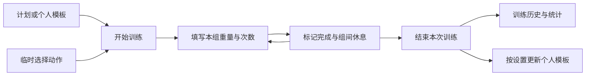
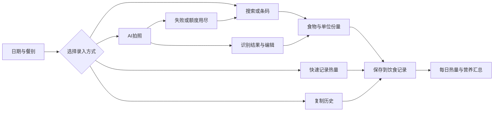
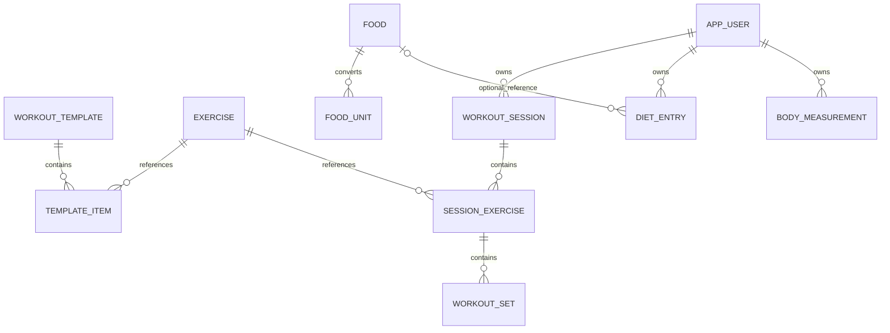

# 训记与薄荷：功能、页面流程、数据模型

分析日期：2026-10-20。目标：为独立开发健身与饮食记录产品提供参考。

**最有价值的组合是训记的逐组训练记录流程，以及薄荷的饮食录入与每日营养反馈流程。** 两者都需要降低重复输入成本，同时保持历史记录稳定。训记包里保留了 SQLite 建表和更新语句；薄荷这份包的业务代码受加固保护，但 Manifest、布局、资源和内置数据库仍可解析。

| 维度 | 训记 7.0.273 | 薄荷健康 15.8.1 |
|---|---|---|
| 本次核心观察 | 动作、模板、计划、逐组记录、历史与 PR | 饮食搜索、份量单位、营养、自定义食物、AI 记录、身体趋势 |
| 主要证据 | REA 包解析、Hermes 字符串表中的页面名和 SQL | REA 包解析、Android 布局、资源表、SQLite |
| 技术观察 | React Native + Hermes HBC 96 | Manifest 含 Android 业务页面；DEX 仅暴露 5 个顶层类，Application 为 `com.stub.StubApp` |
| 模型可见程度 | 21 个建表字面量、7 个迁移字面量；实际设备库未取得 | 取得 5 张业务种子表；核心饮食、用户记录库未取得 |
| 应优先借鉴 | 训练时快速记一组、历史复用、模板与实际记录分离 | 搜索与快速录入、餐别、单位换算、历史快照、识别失败回退 |

## 1. 范围与证据等级

本次分析使用本机已有的 Android 安装包，未启动 App、登录账号或发起业务接口请求。页面控件与包声明属于静态证据，不能据此确认线上入口、当前会员策略或实际跳转条件。包签名真实性未验证。

| 编号 | 证据 | 可以支持的结论 |
|---|---|---|
| E1 | [训记 REA 包摘要](/Users/pengyuehui/Downloads/leanora/analysis/evidence/xunji-package-rea.json) | 包名 `com.trainnote.rn`、版本 7.0.273、JADX 顶层类计数 22,352 |
| E2 | [训记 Hermes 头部](/Users/pengyuehui/Downloads/leanora/analysis/evidence/xunji-hermes-header.json)与[完整字符串表](/Users/pengyuehui/Downloads/leanora/analysis/evidence/xunji-hermes-strings.jsonl) | 143,298 个字符串、字符串 ID 与字节位置；HBC 文件长度及 SHA-1 尾部校验通过 |
| E3 | [训记 SQL 字面量](/Users/pengyuehui/Downloads/leanora/analysis/evidence/xunji-sql-literals.json) | 表名、字段、部分插入和更新方式；不能证明全部分支执行 |
| E4 | [薄荷 REA 包解析](/Users/pengyuehui/Downloads/leanora/analysis/evidence/boohee-package-rea.json)与[业务 Activity 声明](/Users/pengyuehui/Downloads/leanora/analysis/evidence/boohee-activities.json) | 包名 `com.boohee.one`、版本 15.8.1、347 个名称含 `boohee` 的 Activity 声明；数量不是独立用户页面数 |
| E5 | [薄荷布局索引](/Users/pengyuehui/Downloads/leanora/analysis/evidence/boohee-decoded-layout-index.json)与[资源摘录](/Users/pengyuehui/Downloads/leanora/analysis/evidence/boohee-product-resource-excerpts.txt) | 已解码 26 个相关布局；控件、文本和界面状态的静态证据 |
| E6 | [薄荷 REA SQLite 结构](/Users/pengyuehui/Downloads/leanora/analysis/evidence/boohee-sqlite-rea.json)与[记录数量及样本](/Users/pengyuehui/Downloads/leanora/analysis/evidence/boohee-database-inventory.json) | 内置运动目录、提醒和通知表的实际结构与种子数据 |

E1 的原始 REA Evidence ID 为 `ev_048c47930384b04840a6a7a186e4776bfac728e371abd97d169ab3023dee19e8`；E4 为 `ev_874e1ad352f906017ef7e009f9f86550fb91eccc7160653c72fb953a0a9ddabc`；E6 为 `ev_aa086b4794aa89d382417a78d035d4509ec47424be5053416b06477c9ae5f44a`。完整 REA 记录保存在[证据包](/Users/pengyuehui/Downloads/leanora/analysis/evidence/rea-evidence-bundle.json)。Hermes 和 aapt2 提取结果是补充静态证据，没有冒充 REA Evidence。

输入包路径与 SHA-256 见[输入清单](/Users/pengyuehui/Downloads/leanora/analysis/inputs/artifacts.json)。训记 XAPK 的 base APK 已提取；ABI、语言和密度 split 未做逐一代码分析。

## 2. 训记：训练记录是核心数据对象

### 功能与页面

下表中的名称是包内可见的标识，不代表已验证的线上路由注册。

| 功能 | 页面或字段证据 | 开发含义 |
|---|---|---|
| 动作库与动作详情 | `MovePage`、`MoveEditor`、`movements`；HBC 20488、77709、82005 | 动作是可复用资料，训练中保存它的使用实例 |
| 模板 | `TemplatePage`、`TemplateEditPage`、`templates`；20925、3040、82010 | 固定动作组合、顺序与规则，减少下次输入 |
| 训练计划 | `PlanPage`、`UserTrainingPlanPage`、`UniversalPlanEditor`；20620、20619、21074 | 计划可以包含日期、训练日类型和规则，不等同于单次训练 |
| 正在训练 | `TrainPage`、`WorkoutEditor`、`reps`、`weight`、`sets`；39767、21139、216、63、229 | 最小录入单位为组，不能只记录一次训练的总消耗 |
| 组间休息 | `RestTimeSetting`、`resttime`；77765、217 | 计时应该靠近记录动作，减少页面切换 |
| 组类型 | 热身组、递减组、超级组；27686、28381、26207 | 分别建模组类型与组之间的关联，避免一个布尔值承担所有语义 |
| 历史与统计 | `DataHistory`、`TrainDataPage`、`prtables`；42819、20648、80214 | 训练历史、容量、PR 是实际完成记录的派生视图 |
| 身体和饮食 | 身体数据、`FoodEditor`、`FoodUnitEditor`；28251、4350、14833 | 包里也有饮食功能，不能把两款产品简单划成完全不重叠 |
| 手表与外部数据 | Huawei、Xiaomi、Garmin 等页面名和 Manifest 查询项 | 可以规划设备集成；静态声明不证明每个集成都能正常使用 |

另有 `TrainerIndexPage`、`students`、`studenttrains`，表明包中保留了学员管理相关能力。对个人记录产品而言可以后置，不必一起实现。

### 页面流程重建

**节点有静态证据；箭头是本次按功能含义重建的参考路径，未经真机点击验证。**

几条值得保留的交互规则：

- 包内文案说明，添加动作时可以复制该动作最近一次训练记录，并提供开关（HBC 25472）。历史参考应默认就近出现，用户只改变化的数字。
- 包内文案区分个人模板与官方计划；训练结束后可以把变更应用回个人模板（26708）。模板的变化与已完成训练的变化应分开处理。
- 有退出训练、完成确认及手表训练期间禁止调整时间的文案（98027、26701、107629）。开发时需要明确进行中、完成、放弃三种状态。
- 包里有饮食记录的 PRO 提示，也有隐藏饮食模块的设置提示（27004、89030）。它们只证明该版本携带相关文案，不能推断当前统一的收费规则。

### 可直接观察的数据结构

以下字段来自 E3 的 SQL 字面量；说明是本次解释。没有取得训记实际运行后的数据库，故不把它们称为完整现行 schema。

| 表 | 可见字段节选 | 解释 |
|---|---|---|
| `movements` | `id, name, unit, type, exetype, section, MuscleData, superSetType, version` | 动作资料、单位、分类、肌群和版本 |
| `templates` | `id, name, movement, rules, belongto, color, local_order, version` | 模板与规则；动作内容存为 TEXT |
| `localtrains` | `id, openid, datestr, start, end, movement, title, templateid, note` | 一次训练的记录；动作内容存为 TEXT |
| `prtables` | `type, datestr, key, value, issuperset, setidx` | 特定动作或组的记录索引；具体 PR 算法未还原 |
| `histindex` | `datestr, key, move` | 按日期、动作查询的辅助结构 |
| `platformPlans` | `templateid, planid, datestr, dayType, color, workout` | 日期化的计划执行内容 |
| `UniversalPlans` / `UserTrainingPlan` | `planid, storekey, data` / `planKey, data` | 计划配置内容与标识 |
| `platformplanrules` | `templateid, movekey, planid, rules` | 计划内动作的规则配置 |
| `folders` / `notetable` / `systemcomments` | 顺序、备注、图片、版本等 | 内容组织与备注 |

`movement` 和 `data` 的 SQL 声明是 TEXT。字段名与业务标识支持“内部还有嵌套对象”的推断，但本次没有还原这些序列化对象的完整合同。`reps`、`weight`、`rpe` 等字符串分别存在，不证明它们一定是同一个对象的成员。

同步方面可见 `localtrains` 增加 `watch`、`version`、`sync_type`、`delflag` 的迁移语句；更新字面量会增加 `version`，并设置 `sync_type='not_sync'`，删除通过 `delflag` 标记（HBC 74565、75431、75700、75742、84275、84279）。这支持“本地变更带同步状态与删除标记”的判断；服务端如何处理冲突仍未知。

另有 `fivefive` 的建表字面量带尾逗号，不能直接执行。它可能属于遗留或不可达分支，本次未验证。所有原始 DDL 放在[字面量文件](/Users/pengyuehui/Downloads/leanora/analysis/evidence/xunji-schema-literals.sql)，不应直接当作迁移执行。

## 3. 薄荷：从多种输入方式汇总到每日记录

### 功能与页面

Manifest 的 Activity 声明与布局提供了两类互相补充的证据，但不提供实际点击关系。

| 功能 | 代表性 Activity 简名 | 布局直接可见内容 |
|---|---|---|
| 评测与目标 | `NewUserEvaluatingActivity`、`WeightTargetActivity` | 分步评测、修改基础信息、生成方案的提示 |
| 饮食记录 | `AddFoodListNewActivity`、`DietSportCalendarActivity` | 餐别、已添加列表、完成、日历 |
| 查找食物 | `FoodSearchActivity`、`FoodDetailV2Activity` | 搜索历史、推荐、收藏标识、记饮食 |
| 自定义食物 | `AddCustomFoodActivity`、`CustomFoodActivity` | 名称、数量、单位、热量；蛋白质、脂肪、碳水、纤维、钠 |
| 份量与营养 | `FoodNutritionInformationActivityV2` | 单位列表、可食部、整体重量、营养素、NRV% |
| 快速记录 | 饮食记录页的快速记录入口 | 餐别和热量必填；名称、图片、三大营养素选填 |
| AI 拍照 | `DietCameraRecordActivity`、`DietCameraResultActivity` | 识别中、失败、额度用尽、食物列表、保存 |
| AI 对话 | `AiChatActivity`、`AiMemoryActivity` | 拍照、文字和语音入口；记体重、饮水、运动等快捷项 |
| 身体趋势 | `WeightRecordActivityNew`、`WeightCurveActivity`、`GirthRecordActivity` | 手动和秤记录入口、记录列表、批量删除 |
| 运动 | `SportRecordMainActivity`、`SearchSportActivity` | 日期、运动记录、推荐消耗信息 |
| 健康扩展 | 饮水、睡眠、经期、习惯、家庭档案等声明 | 模块数量较多；本次只聚焦训练与饮食相关流程 |

社区、商店、订单、会员等也有大量声明。开发核心记录功能时，不需要复制整个平台。

### 饮食录入参考流程

**下面的箭头为参考流程重建；页面及控件存在由 E4、E5 支持，真实导航和提交行为未验证。**

有几处细节直接影响开发设计：

1. **允许只知道热量。** 快速记录布局把餐别、热量标成必填，而三大营养素选填。因此“未知蛋白质”必须与“蛋白质为 0”区别存储。[快速记录布局](/Users/pengyuehui/Downloads/leanora/analysis/evidence/boohee-layouts/dialog_diet_quick_record.txt)
2. **份量不是只有克。** 布局存在单位列表、整体重量和可食部，应把用户选择的份量与换算后的可食克数分开。[份量布局](/Users/pengyuehui/Downloads/leanora/analysis/evidence/boohee-layouts/view_eat_weight.txt)
3. **保护历史数据。** 自定义食物布局有创建后不可修改的提示。这是保持历史一致性的一种产品处理；独立开发也可采用可编辑资料加历史快照的方式。[自定义食物布局](/Users/pengyuehui/Downloads/leanora/analysis/evidence/boohee-layouts/activity_add_costom_food.txt)
4. **AI 必须有手动出口。** 结果布局同时携带识别中、重新上传、手动搜索和额度耗尽的提示，也有后台识别并自动记录的提示。这里只确认这些状态被打包，不能认定每条记录都强制人工确认。[识别结果布局](/Users/pengyuehui/Downloads/leanora/analysis/evidence/boohee-layouts/app_act_diet_camera_result.txt)
5. **重复录入有快捷路径。** 饮食记录页包含复制、快速记录、条码入口；搜索结果还能显示收藏与记录过的状态。[饮食记录布局](/Users/pengyuehui/Downloads/leanora/analysis/evidence/boohee-layouts/activity_add_food_list_new.txt)

### 实际取得的数据库

`assets/bhdb.sqlite` 为 133,120 字节，有以下 5 张业务表和 1 张 SQLite 内部自增表。

| 表 | 行数 | 关键字段 | 可确认的用途 |
|---|---:|---|---|
| `sports` | 568 | `id, name, group_id, mets, ...photo_url, score, status` | 内置运动目录 |
| `sport_groups` | 16 | `id, name, order_index, status` | 内置分类 |
| `alarms` | 14 | `code, hour, minute, daysofweek, enabled, type, sound` | 默认提醒配置 |
| `alarm_tips` | 234 | `message, code, name` | 提醒文案 |
| `notices` | 0 | `alarm_tip_id, is_opened, created_at, alarm_tip_message` | 通知结构 |

**这不是完整食物数据库，也不是登录用户的记录库。** 不能由此宣称取得薄荷的食物营养数据、减重算法或云端表结构。`mets` 样本包含 200、750、1000 等值，缩放与单位没有得到代码证实，不能直接作为标准 MET 数值用于计算。

## 4. 独立开发的数据模型建议

本节是分析后的设计建议，**不是两款 App 的原始实现**。已提供可在 SQLite 中建表的[13 表参考 schema](/Users/pengyuehui/Downloads/leanora/analysis/开发参考-schema.sql)。

| 对象 | 应保存的内容 | 原因 |
|---|---|---|
| 动作 `exercise` | 名称、类型、肌群 | 资料与某次实际训练分离 |
| 模板及项目 | 顺序、目标组、目标次数或负重、规则版本 | 计划值与完成值含义不同 |
| 单次训练 | 开始结束时间、状态、日期、模板版本、备注 | 支持中断、继续与历史查询 |
| 单次动作及组 | 动作名称快照、顺序、实际重量次数、时长、距离、组类型、休息、可选 RPE | 保留逐组信息和不同动作的计量方式 |
| 食物与单位 | 营养基准、来源、版本、每单位可食克数 | 食物资料可更新，换算有出处 |
| 饮食记录 | 餐别、时间、数量单位、当次热量营养快照、来源 | 修改食物资料不应改写过去摄入量 |
| 营养目标 | 生效日期、热量和营养目标 | 调整今天的目标不重算过去目标 |
| 身体测量 | 指标、数值、单位、时间、来源及外部记录 ID | 体重、围度与设备导入分别处理 |
| 运动消耗记录 | 日期、时长、消耗及来源 | 避免同一训练同时从 App 和设备重复计入 |

参考 schema 的单位统一采用 kg、m、秒、kcal、g；钠使用 mg。饮食快速记录允许 `food_id` 和营养素为空；历史记录保存独立快照。服务端授权、同步事务、冲突策略以及 AI 作业管理不由这个本地模型解决。

### 关键实现决定

- **训练容量先定义统计口径。** 正式组、热身组、自重、辅助重量、超级组分别如何计入，需要自己明确；本次没有还原训记的公式实现。
- **不要把计划修改传播到历史。** 开始训练时记录计划版本；动作和食品保留当次快照。
- **按本地日期看日记，按 UTC 保存时刻。** 同时保存发生地时区，跨午夜和旅行时才不会把记录分错天。
- **把实际录入和 AI 建议分开。** 拍照或语言识别可以先生成候选记录，再修正份量或餐别；这是本次建议，薄荷也携带自动记录路径的文案。
- **同步必须能重试。** 本地生成稳定 ID，更新带版本，删除保留标记。设备导入使用来源记录 ID 去重；服务端协议另行定义。
- **先展示已有记录，再算趋势。** 食物搜索需要资料来源，图表需要明确聚合规则；静态分析不能代替营养数据库或健康建议算法。

## 5. 建议的开发顺序

| 阶段 | 建议范围 | 可检查的结果 |
|---|---|---|
| P0 | 动作与模板、逐组记录、结束训练、历史；食物搜索、份量、餐别、快速记录；体重 | 用户完整记下一次训练和一天饮食，重开后仍可查到 |
| P1 | 最近记录复用、历史复制、休息提醒、营养目标、趋势、同步去重 | 重复记录更省输入，修改资料不会改变历史 |
| P2 | AI 拍照和语音、进阶计划、设备集成 | 智能输入有可编辑结果、失败状态和手动出口 |
| 后续扩展 | 教练学员、社交、商城、课程、复杂会员体系 | 按产品定位选择，包里存在不等于首版需要 |

若目标是将两者组合进一个产品，建议先围绕“训练日”与“每日饮食”两条记录流程组织。首页呈现今日训练状态、饮食汇总和最近体重，各模块共享日期与用户，而各自保留适合的明细结构。

## 6. 已回答与未验证项

| 问题 | 本次状态 |
|---|---|
| 核心功能与代表页面 | 已依据包声明、字面量与布局整理 |
| 页面之间的真实跳转条件、布局实际呈现 | 部分回答；提供参考流程，没有运行时验证或截图 |
| 训记持久化模型 | 已取得建表与迁移字面量；实际设备库和嵌套对象合同仍未知 |
| 薄荷数据模型 | 已取得内置种子库；核心业务对象给出独立设计建议 |
| 云端接口合同、鉴权、同步冲突处理 | 未验证，本次不作恢复成功的声明 |
| AI 模型、识别准确率、热量和 PR 算法 | 未验证 |
| 当前会员权益、线上开关、包真实性 | 未验证 |

官方产品说明可作为定位补充：[训记 App Store 开发者介绍](https://apps.apple.com/cn/app/id1464915553)强调训练记录与分析；[薄荷官网](https://www.boohee.com/)介绍食物查询、拍照与健康记录。这些公开说明不用于替代本次具体 Android 版本的证据。

安装和复用命令见 [REA 安装说明](/Users/pengyuehui/Downloads/leanora/REA-安装说明.md)。
