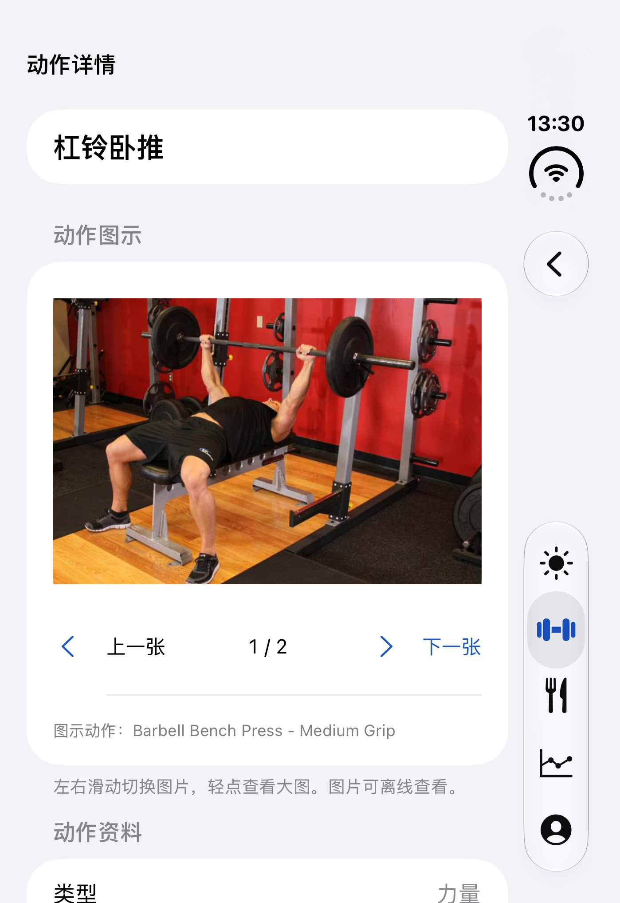
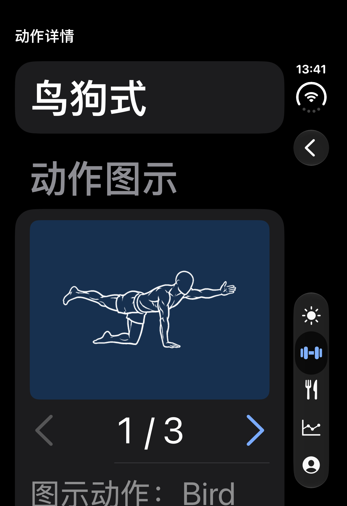
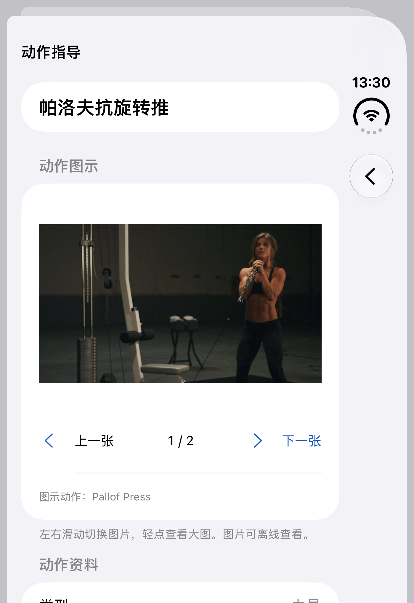
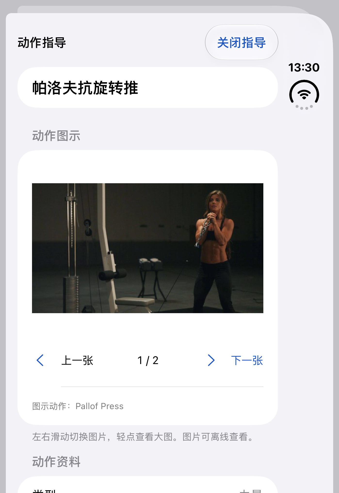

# 动作库扩充验收

日期：2026-10-22。范围：源码、离线资源、macOS 基础测试与 iOS 27.1 模拟器。未上传或替换 App Store 构建。

## 结果

- 882 个内置动作，全部有指导图；1765 张独立图片，72,036,917 字节。
- 原 100 个动作与基线 JSON 逐字段相等。新增 ID 使用固定命名空间 UUID v5，重复生成不会产生新 ID。
- 284 个中文名称；原 100 个动作有中文提示，其他名称及步骤按来源原文展示。无图的三个上游条目排除。
- 104 项基础测试：0 失败，2 项原有大容量测试默认跳过。
- 四个不同的页面用例最终均通过；超大字体翻图按钮修正后再次通过。
- 原生 App 包中的 1765 张图片与来源清单逐文件哈希一致，两个目录 JSON 与源码一致，三个完整许可/署名文件随包存在。

## 主要验证

| 场景 | 结果 |
| --- | --- |
| 随包目录加载与逐图解码 | 每个内置动作都有本地文件 URL，1765 张图片通过 ImageIO 解码 |
| 旧数据与归档行为 | 原字段保持；旧模板/记录与原有备份测试通过 |
| 新动作完整业务链 | 帕洛夫抗旋转推 → 保存模板 → 开始训练 → 备份导出/导入，动作 ID 保持，备份不含教学图片或说明 |
| 组合筛选 | 名称/英文别名、器械、肌群、难度与类型共同生效；胸部筛选仍包含原杠铃卧推 |
| 计量例外 | 悬吊划船、弹力带辅助引体与吊环臂屈伸按自重次数；平衡板按时长；哑铃 Iron Cross 按负重次数 |
| 照片指导 | 翻页、全屏大图、关闭后保留页码、来源展示通过 |
| 选择动作前预览 | 打开预览再返回不会新增条目；明确点击选择只添加一个条目 |
| 训练中指导 | 打开并关闭后仍返回同一训练，已有组保持 |
| 深色与超大字体 | 白色线稿在深色底上可见；箭头按钮有足够点击区域和朗读标签，翻页通过 |
| 原目录检索回归 | BENCH 搜索、哑铃筛选、进入原哑铃卧推并查看原有来源通过 |
| 资源隔离 | 图片与步骤均不请求网络、不写入用户业务备份；没有引入 openGym 的受限媒体 |

初测发现两处自动化定位问题：超大字号引导页按钮位于屏幕下方；扩充后的 BENCH 结果比原目录更多，旧用例不应假设首屏存在某一行。用例已改为滚动定位和验证筛选前后数量。截图核看另发现超大字号翻图文字挤压，已将可见按钮改为带朗读标签的箭头，重测通过。

## 可重复验证

```sh
python3 app/scripts/validate_exercise_catalog.py
swift test --package-path app --scratch-path app/build/SwiftPM --disable-swift-testing
```

UI 用例位于 `ExerciseGuidanceTests`，以及 `TemplateEditorTests/testCatalogSearchEquipmentFilterAndSource`。本次使用 `Leanora U3 Verified`（`C7E5E80A-8BB8-4A54-B93E-C18057CE452F`）独立测试数据域。Xcode 命令设置 `SWIFT_EMIT_LOC_STRINGS=NO`，已有未提交的字符串文件没有改动。

原始日志和结果保存在忽略的 `app/build/`：`exercise-guidance-core-final.log`、`ExerciseGuidance-20261022-1.xcresult`、`ExerciseGuidance-20261022-2.xcresult`、`ExerciseGuidance-20261022-3.xcresult`。第一次失败后的附加系统诊断收集长时间未结束，已仅结束该诊断子进程，使测试结果正常保存；后续关闭冗长系统诊断收集，保留截图与结果。

[App 包核验](bundle-audit.json) · [正确性复核](correctness-review.json) · [内容来源与重建方法](../../exercise-library-expansion.md)

## 视觉证据

下列截图使用隔离示例数据及允许再分发的动作素材。图库图片分别保持 Unlicense 或 CC BY-SA 4.0；Bryl Lim / Everkinetic 的署名和许可见[第三方清单](../../../THIRD_PARTY_NOTICES.md)。照片页的截图早于翻图按钮改成箭头；深色大字号截图为最终布局。









## 范围说明

没有新增视频；使用已有照片或姿态插图。不宣称全部内容经过专业教练审定或完成全量中文翻译。辅助双杠页面明确说明图中为无辅助基础双杠轨迹，器械设置参见其中文步骤。最低支持系统真机、真实 VoiceOver 操作及正式发行体积仍需在发布流程中核验。本次没有修改已送审的 1.0（4）记录。
