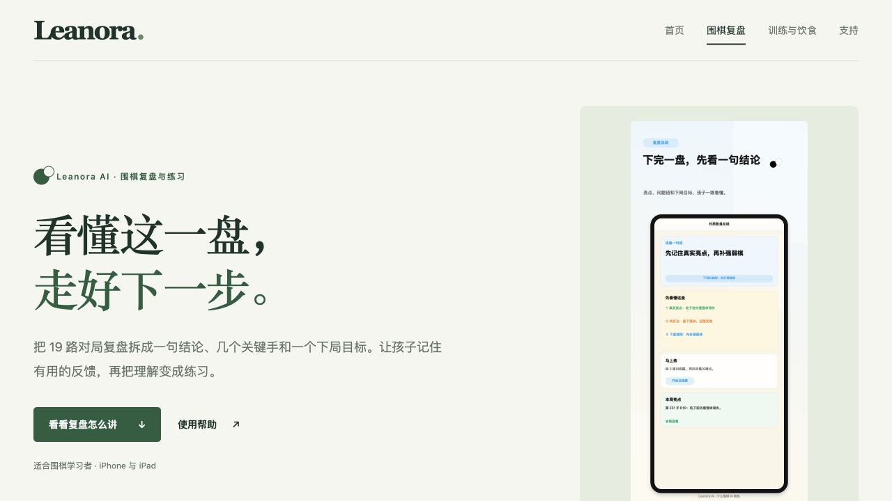
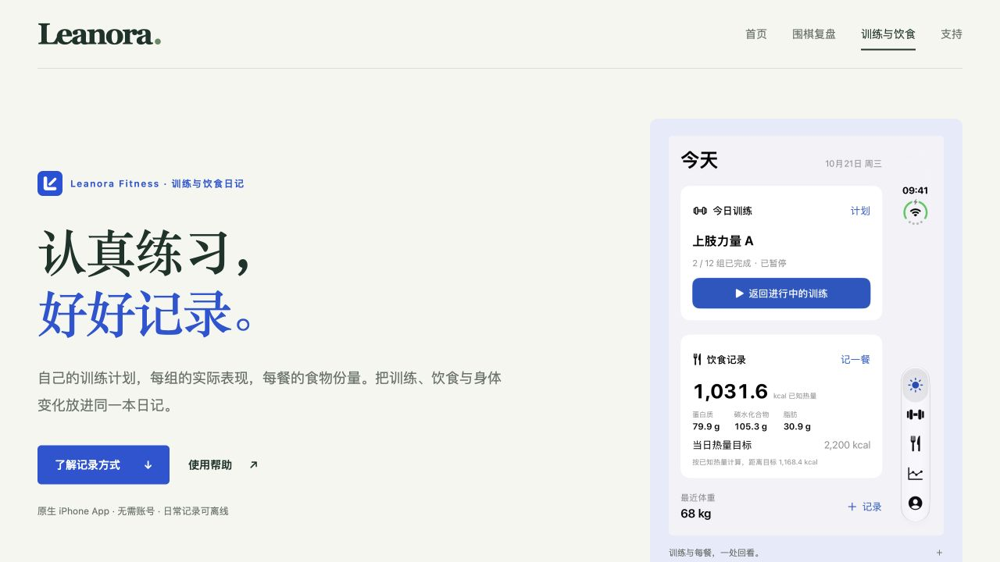

# Leanora 双产品网站改版验证

日期：2026-10-22。范围：本地静态站点与上传包；未部署到线上。

## 设计结果

首页由原围棋单产品介绍改为双产品入口，完整路径为“品牌首页 → 产品详情 → 对应帮助与隐私”。共同的字标、暖白纸色、宋体标题与留白建立品牌一致性，绿色围棋与蓝色健身区分产品。详情页使用现有公开素材与实际 App 截图，不引入虚构功能或尚未确认的下载地址。

手机上将两个快捷入口放在产品展示前，避免第二款产品被首屏长内容遮挡。围棋、健身政策正文分开保留；支持中心先让用户选产品，减少误读。

## 验证证据

| 项目 | 结果 |
| --- | --- |
| 九个页面，390 × 844 | 单一主标题，无横向溢出，无可见破损图片 |
| 九个页面，1280 × 720 | 单一主标题，无横向溢出 |
| 手机导航 | 展开、产品跳转、Escape 关闭及焦点恢复通过 |
| 产品截图放大 | 正确图片和说明，Escape 关闭，滚动恢复，焦点返回触发按钮 |
| 围棋常见问题 | 原生折叠项展开通过 |
| 桌面产品 → 支持 → 健身隐私 | 正确到达 `/fitness/privacy/` |
| 旧首页三个功能锚点 | 跳转至 `/go/`，目标节点均存在 |
| 静态内容与资源 | 九个路由、232 个站内引用、图片替代文本与唯一 ID 通过 |
| 既有法律与支持正文 | 围棋隐私、健身隐私、健身支持的规范化正文保持一致 |
| 压缩包 | 仅包含公开页面、资源与清单；逐文件哈希及归档内容一致 |
| 浏览器控制台 | 健身页检查未捕获错误 |
| 脚本语法与补丁 | JavaScript 语法及 `git diff --check` 通过 |

浏览器结构与交互结果保存在 [browser-checks.json](browser-checks.json)。静态检查可用 `python3 app/scripts/validate_public_site.py` 重复执行。

## 发布边界

当前结果不代表线上已更新。用户通过 SCP 上传后，还需验证服务器目录映射、HTTPS、缓存与公开地址。未修改 App Store 提交状态；此前提交的支持与政策 URL 保留。没有加入商店下载按钮，因为未核实两款产品的正式公开下载地址。
