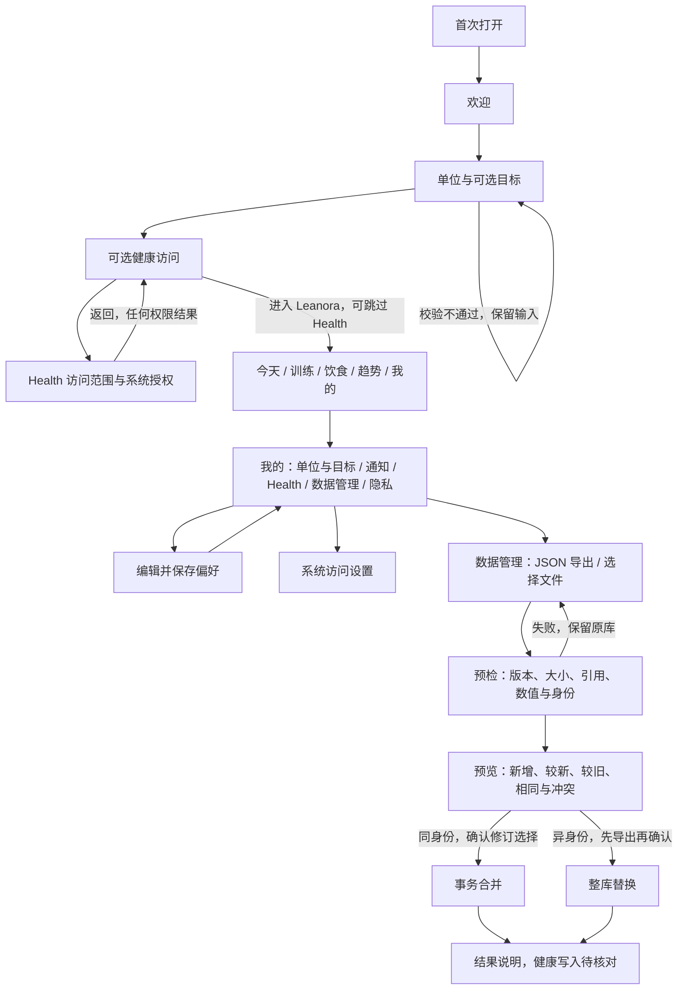

# 阶段 1–3 页面与交互

更新：2026-10-20。设计为项目原创：暖白背景、深绿主色、系统衬线标题与易读的原生正文；深色模式使用深绿背景和浅绿强调。颜色不承担唯一的状态表达。

## 首次使用

1. 欢迎页解释用途，点击“开始设置”。页面可滚动，避免大字体下隐藏入口。
2. 选择重量、距离单位；每周训练与每日热量可空。点击“下一步”时统一校验并保存；出错展示文本，不移动到下一页。
3. 可进入 Health 设置，也可直接“进入 Leanora”。隐私说明随时可查看。返回上一步保留已保存的偏好。
4. 完成后保存首次使用标记。再次启动直接进入今天，不重复弹权限框。

## 主导航

| Tab | 阶段 1 可操作内容 |
|---|---|
| 今天 | 当前日期、真实空状态、训练/饮食/趋势跳转、已设目标与偏好编辑 |
| 训练 | 空记录状态、训练日记说明、偏好编辑 |
| 饮食 | 空记录状态、份量与未知营养说明、偏好编辑 |
| 趋势 | 空记录状态、趋势与来源说明、偏好编辑 |
| 我的 | 单位与目标、通知访问、Apple Health、隐私与数据 |
| 我的 · U2 新增 | 数据管理、敏感资料导出说明、原生文件选择、预检错误、导入预览、异身份替换确认 |

各 Tab 保留独立 NavigationStack；首页快捷入口改变 Tab 选择。子页面使用系统返回导航。没有记录时不显示样例图表、虚构统计或不可执行的“新增”按钮。

## 阶段 3 训练流程

U3 训练区域已替换空状态：动作库（搜索/筛选/来源/自定义/归档）→ 模板（重复项目、目标、菜单重排/复制、每周日期）→ 周计划（按日安排、单次改期）→ 开始当天训练。开始后展示独立计划快照，并可从今天/训练返回或确认放弃。模板编辑采用草稿，明确取消时确认放弃；保存期间禁用输入。模板文本及目标数字键盘有独立“完成”入口，选择动作前先收起模板键盘。

周计划的“开始”和“仅改这一次”各自响应，改期不创建训练；复制模板不继承每周日期。归档不删除历史，删除模板也保留已开始快照。U4/U5 交互见 [训练、饮食与身体功能合同](workout-and-nutrition.md)。

## 阶段 4、5 记录流程

训练：打开进行中的训练 → 编辑实际组 → 保存 → 确认完成此组 → 独立休息提示；可暂停、强退后继续或确认结束。历史支持组/备注编辑、确认更正时间与删除，统计自动重算。模板菜单可配对或解除两个力量动作的超级组。

饮食：选择日期/餐次 → 离线搜索 → 核对来源/份量 → 查看本次数量营养 → 保存；或直接快速记热量。历史复制创建独立记录，自定义变更不改历史快照。新增、快速记录、复制和编辑共用一个弹窗入口，关闭动画结束前禁用重新打开，避免连续操作时的呈现冲突。

身体与趋势：7/30 天及截至日期 → 身体记录 → 新增/编辑/删除测量；同日多次记录都保留，曲线明确使用每日末次值。今天与日记使用同一营养计算器，部分或未知营养素不标成达标。

## 权限状态

| 场景 | 页面行为 |
|---|---|
| Health 不可用 | 显示设备不可用说明，仍可返回并完成首次使用 |
| 未选择任何 Health 类型 | 提示先选择访问范围，请求按钮禁用 |
| Health 请求进行中 | 请求按钮和范围开关禁用，显示等待系统回应 |
| Health 请求处理完成 | 只说明系统请求已处理；若申请写入，显示当次选择中当前可写类型数；不宣称读权限或同步成功 |
| Health 请求失败 | 文本错误、可再次请求、可返回；不保存成功请求日期 |
| Health 曾请求但重新启动 | 仅显示“曾完成系统访问设置”；不会恢复为“全部授权” |
| 通知未设置 | 用户主动点击后才请求系统访问 |
| 通知拒绝 | 清楚说明未开启，保留系统设置入口与全部导航 |
| 通知允许 | 显示状态和待送达数量；安排休息/计时及可选未来 14 天训练提醒，提供系统设置入口 |
| 从系统返回 | 通知状态刷新；Health 读取权限仍以系统允许范围为准 |

## 无障碍检查口径

使用语义化 Button、NavigationLink、Toggle、Picker，提供中文标签和测试标识。布局随系统字体变化，长文可滚动；装饰性品牌图形不朗读；错误有文本与图标，主按钮至少 52pt，普通关键操作至少 44pt。减少动态效果开启时取消步骤切换动画。

大字体与深浅色可以自动截图检查；VoiceOver 的焦点顺序、实际播报和手势必须在真实 iPhone 上人工验收。不能以存在 accessibilityIdentifier 替代 VoiceOver 验收。
