# Leanora 训练、饮食与 Apple Health App 开发计划

## 1. 结论与产品边界

开发一个 **iPhone 优先、离线可用、训练与饮食记录一体化、支持 Apple Health 同步的独立原生 App**。内部项目名暂用 Leanora，正式名称与 Bundle ID 在项目初始化时确定。

已确认的产品决定：用户希望闭源商业化，因此 OpenGym 用于功能研究；不从该仓库移植代码、测试、图标、界面资源或动作数据库。训记、薄荷的分析用于理解流程与对象关系，不使用其私有接口、素材或食物库。

**建议技术路线：SwiftUI + SwiftData + HealthKit + Swift Charts + UserNotifications。** 第一版完成本机记录与健康同步，先通过 TestFlight 验证；账号云同步、付费订阅和 Apple Watch 独立训练另列后续交付。

这份文件是持续更新的实施计划。2026-10-21：U1–U8 的首版本机实现已完成，包含真实 HealthKit 读写适配、分页/观察器/幂等队列/删除抑制/恢复核对、CSV 与分离清理、100 动作/300 食物，以及参考训记记录流程的原创布局。单元、容量、原生页面及 SDK 真实授权/体重写入回声均有验证。物理 iPhone（最低/当前系统）、后台/锁屏、多来源统计、VoiceOver 听读、内容专业审核，以及签名 TestFlight 仍为外部验收门槛，不能算作已发布。详见 [最终验收记录](/Users/pengyuehui/Downloads/leanora/app/docs/qa/release-acceptance.md)。

### 本次默认假设

- 首发 iPhone，建议最低 iOS 18；采用实施时可提交 App Store 的稳定 Xcode/SDK。最低系统版本是本次规划建议，不是用户已确认的设备清单。
- 简体中文优先，字符串集中管理；日期、数字和计量单位遵循地区设置。
- 首版单设备、免注册即可使用。这里的“同步”首先指本 App 与 Apple Health，不意味着完整 App 数据可跨设备恢复。
- 目标是个人力量训练、饮食与身体趋势记录；不承担诊疗或自动开具减重处方。
- 首版由 1 名 iOS 主力开发，设计和 QA 提供阶段性支持；排期据此估算。

## 2. 调研依据与复用决定

### 已核查的 OpenGym

调研快照：`alexpcosta/opengym`，commit **678bf5bf10446e8997a77d43e89c9b2721d8d0fc**。本机研究副本位于 `/Users/pengyuehui/Downloads/leanora/sources/opengym`，不作为未来 App 的源码依赖。

| 观察 | 对本项目的决定 |
|---|---|
| React 19、Vite、Zustand、Capacitor 7；自托管 API 和独立移动端是两种模式 | 研究其用户能力，不沿用 WebView 架构；用原生层直接处理健康与生命周期 |
| 训练模板、周计划、逐组训练、休息、超级组、计时动作、历史、RPE/RIR、渐进规则 | 优先实现记录流程；复杂渐进规则分到后续版本 |
| 自托管版具备账户和服务端同步；移动端把状态镜像到本机 JSON 文件 | 不把“移动端已有云同步”当作基础；独立设计本机持久化 |
| README 提到从 Apple Health 导出文件导入体重 | 文件导入不等同于 HealthKit 自动双向同步，需要独立同步模块 |
| 自有代码 AGPL-3.0；NOTICE 有应用商店分发例外 | 例外没有把源码变成闭源许可；本项目按已确认的独立实现路线执行 |
| 动作名称、说明和媒体另有数据集条款 | 不直接抓取其动作素材；建立自有或另行获许可的内容清单 |

依据：[OpenGym README](https://github.com/alexpcosta/opengym/blob/678bf5bf10446e8997a77d43e89c9b2721d8d0fc/README.md)、[移动端说明](https://github.com/alexpcosta/opengym/blob/678bf5bf10446e8997a77d43e89c9b2721d8d0fc/docs/MOBILE.md)、[许可证](https://github.com/alexpcosta/opengym/blob/678bf5bf10446e8997a77d43e89c9b2721d8d0fc/LICENSE)、[素材及例外说明](https://github.com/alexpcosta/opengym/blob/678bf5bf10446e8997a77d43e89c9b2721d8d0fc/NOTICE.md)。

### 前一轮分析带入的决定

来源：[训记与薄荷开发参考报告](/Users/pengyuehui/Downloads/leanora/analysis/训记与薄荷-开发参考.md)、[13 表参考模型](/Users/pengyuehui/Downloads/leanora/analysis/开发参考-schema.sql)。二者不是第三方完整源码或真实服务端合同。

1. 模板和已完成训练独立，动作及食物保存历史快照。
2. 训练记录细到每一组；实际重量、次数、时间与计划目标分开。
3. 饮食同时支持搜索、份量和“只知道热量”的快速记录；营养素未知不能存成 0。
4. 来源、版本、归日时区和删除标记从第一版进入模型。
5. AI 拍照不能阻塞手工录入；但 AI 不进入首版关键路径。

工作区没有现成 App，也没有可继承的 `docs/solutions/` 或匹配的 requirements 文档。本计划以用户需求、已确认的闭源路线和上述报告为输入。

## 3. 需求与验收目标

### 平台与数据

| 编号 | 需求 | 验收方式 | 实施单元 |
|---|---|---|---|
| R1 | 独立闭源实现，记录每个第三方库及内容来源 | App 交付目录不含 OpenGym/训记/薄荷代码和素材；依赖与内容许可清单可核查 | U1、U8 |
| R2 | iPhone 原生、离线、免登录 | 飞行模式完成训练、饮食、体重记录；强退后可恢复 | U2–U5 |
| R3 | 稳定持久化、历史快照和版本化迁移 | 更新模板/食物后旧记录不变；升级失败不清空数据 | U2、U8 |

### 用户功能

| 编号 | 需求 | 验收方式 | 实施单元 |
|---|---|---|---|
| R4 | 动作、训练模板、周安排 | 可新建、调整顺序、复制并开始当天训练 | U3 |
| R5 | 重量次数、计时动作、基础有氧、组类型、超级组、可选 RPE/RIR、休息计时 | 完成完整训练；后台返回后时长正确；未完成组不进入完成统计 | U4 |
| R6 | 饮食、份量换算、餐别、快速记录、复制历史、自定义食物 | 记录全天饮食；100g 基准与份单位换算一致；未知营养素可见 | U5 |
| R7 | 体重与体脂记录、训练历史、容量与单组最大负重 PR | 保留一天多次测量；区分来源；容量和 PR 口径可查看 | U4、U5 |

### Apple Health 与交付

| 编号 | 需求 | 验收方式 | 实施单元 |
|---|---|---|---|
| R8 | 按数据类型授权，拒绝或部分授权仍可使用 | 不依赖健康权限完成核心记录；无读取数据时不误报“已拒绝” | U6 |
| R9 | 健康读取与写入，含增量、去重、编辑、删除和失败重试 | 同一业务记录重复同步不增加样本；能处理替换样本和外部删除 | U6、U7 |
| R10 | 用户能理解同步状态与数据来源 | 设置展示读写方向、最近检查、待同步与失败项；记录可查看来源 | U6、U7 |
| R11 | 可导出、导入及明确清除数据 | 版本化 JSON 往返保留业务 ID；CSV 导出可读；重置不会误删其他 App 的健康数据 | U2、U8 |
| R12 | 无障碍、隐私与 TestFlight 交付 | 真机验收、可用的隐私入口、权限说明、动态字体和 VoiceOver | U1、U8 |

这些是交付验收目标，不是已经测得的结果。

## 4. 第一版功能与后续范围

| 第一版必须完成 | 第一版后的增强 | 独立后续项目 |
|---|---|---|
| 训练模板、周安排、逐组记录、休息、超级组、计时动作 | 线性递增、双重递增、停滞处理、进阶 1RM 分析 | Apple Watch 独立 App、实时心率与传感器训练 |
| 本地食物搜索、自定义食物、单位、快速记录、餐别、历史复制 | 条码、线上中文品牌库、食谱与更完整微量营养素 | AI 拍照和语音教练 |
| 体重/体脂、日历、训练与营养趋势 | 围度、饮水和更多数据类型 | Android 与 Health Connect |
| Apple Health 的约定类型和同步规则 | 更长历史回填、更多外部运动类型 | 账号、多设备同步、Web 管理端 |
| 手动导出导入、隐私与无障碍 | 导入其他训练 App 的公开文件格式 | 订阅购买、权益与恢复购买 |

“闭源商业化”已经确定，但售价、免费额度和订阅权益尚未确定。第一版先做可独立使用的产品；付费机制不提前侵入训练和健康模块。

## 5. 页面与主要流程

采用五个 Tab：**今天 / 训练 / 饮食 / 趋势 / 我的**。完整食物库、模板编辑、记录详情使用子页面；正在进行的训练始终有可返回入口。

| 区域 | 具体页面 | 关键交互与状态 |
|---|---|---|
| 首次使用 | 欢迎、单位与目标、可选健康连接 | 跳过健康连接也能进入；目标可手填，不强制提供身体资料 |
| 今天 | 日期、今天训练、餐次摘要、最近体重 | 今天与历史日期明确区分；没有数据时显示记录入口，不显示虚构完成率 |
| 训练 | 动作库、动作详情、模板、周安排 | 搜索/肌群/器械筛选，自定义动作；模板编辑不改历史 |
| 训练中 | 动作列表、组编辑、休息、结束确认 | 默认复用最近实际值但标为未完成；一键完成一组；删除/放弃有确认 |
| 训练详情 | 时长、动作与组、备注、来源 | 历史可编辑；完成状态、暂停和组类型参与统计 |
| 饮食 | 日历、餐别、添加食物、数量单位、快速记录 | 名称可空但热量必填的快捷路径；复制历史后允许修改日期餐别 |
| 身体与趋势 | 体重/体脂录入、训练量、周月趋势 | 最新测量与平均值明确命名；未知营养素显示缺失，而不是达标 |
| 我的 | 单位、提醒、Apple Health、数据管理、隐私 | 不把云同步、Apple Health 和文件备份混成一个开关 |

建议训练状态：草稿 → 进行中 → 暂停 → 完成；放弃为另一终态。暂停恢复、跨日、切后台及强退恢复都保留同一训练 ID。休息和计时动作保存截止时刻或开始时刻，界面计时器只负责显示，不能靠持续后台执行累加时间。

首版同设备只允许一个进行中的训练，再次开始时返回该训练或明确放弃。暂停训练会暂停计时动作并记录暂停区间，休息计时仍按自然时间到期，恢复时显示剩余或已到期状态。超级组首版支持两个力量动作成对，每轮两个动作的组完成后提示休息；多动作联组后续扩展。

训练按开始时的本地日期归日；饮食和测量按记录发生地日期归日。编辑实际时间会重新计算归日，显示确认；跨午夜训练只算一次。

设计验收还包含：数字输入适合单手操作；关键触控区域至少 44pt；Dynamic Type、VoiceOver、深浅色、减少动态效果；PR、失败、营养状态不能仅用颜色区分。

## 6. 技术架构与替代方案

### 推荐结构

| 层 | 选择 | 原因 |
|---|---|---|
| UI | SwiftUI + Swift Charts | 原生输入、无障碍、图表与系统生命周期集成 |
| 业务 | 独立 Swift 类型与服务，按训练/营养/身体划分 | 不让 View 承担计算、同步及持久化逻辑 |
| 存储 | SwiftData、本地 ModelContainer、版本化 schema | 离线存储与原生生态一致；通过专用持久化 actor 处理导入和同步写入 |
| 健康 | 原生 HealthKit 适配层 + 持久化同步队列 | 精确控制类型、权限、增量与业务映射 |
| 提醒 | UserNotifications | 训练提醒与休息提醒采用系统通知；通知被拒绝时保留前台提示 |
| 备份 | 版本化 JSON、CSV；用户主动操作 | 首版不需要用户账号或后端 |

SwiftData 明确关闭自动 CloudKit 同步；使用显式迁移计划。这里选择 SwiftData，不把前一轮参考 SQL 原样当成 App 数据库迁移。[本地存储与 CloudKit 配置](https://developer.apple.com/documentation/swiftdata/syncing-model-data-across-a-persons-devices)、[版本化 ModelContainer](https://developer.apple.com/documentation/swiftdata/modelcontainer)。

备选方案已考虑：

- **React Native**：适合 Android 同期首发；本次仍需独立实现 JS 业务和健康桥接，当前 iPhone/HealthKit 优先时增加跨层调试，暂不采用。
- **Capacitor**：可独立实现，但闭源路线已失去直接移植 OpenGym 的主要收益，原生健康与生命周期需求更适合 SwiftUI。
- **SQLite/GRDB**：更直接控制 SQL 与事务；本次模型规模可先采用 SwiftData。若 U2 的批量同步事务、迁移或性能验证不满足门槛，在形成首个用户数据版本前切换；一旦发布数据版本，不随意更换存储。
- **CloudKit**：不作为健康记录备份方案。Apple 对个人健康信息存入 iCloud 有明确限制，不能因 SwiftData 能自动同步就默认开启。[App Review 5.1.3](https://developer.apple.com/app-store/review/guidelines/#health-and-health-research)

### 模块关系

以下图用于评审整体方向，不是需要逐字复制的实现规格。

```mermaid
flowchart TB
  UI[SwiftUI 页面] --> W[训练业务]
  UI --> N[营养与身体业务]
  W --> DB[本地持久化 actor]
  N --> DB
  DB --> Q[健康写入队列与映射]
  Q --> HK[HealthKit]
  HK --> IN[增量读取与来源识别]
  IN --> DB
  DB --> SUM[日汇总与趋势]
  SUM --> UI
  DB --> BACKUP[用户主动导出导入]
```

首版不建设通用插件系统、微服务或独立 AI 服务。健康类型数量少，按明确类型处理，不引入面向所有平台的抽象框架。

## 7. 数据模型与内容来源

### 业务实体

沿用前一轮模型的领域划分，调整为 SwiftData 实体及独立值对象：

| 对象 | 关键内容及约束 |
|---|---|
| LocalProfile | 本机身份 UUID、单位和时区；为后续账号合并保留稳定 ID |
| Exercise | 名称、动作计量类型、器械、肌群、内容来源；不复制第三方说明文案 |
| WorkoutTemplate / TemplateItem | 动作顺序、计划组、目标次数范围、负重和休息；版本化 |
| WorkoutSession / SessionExercise / WorkoutSet | 实际组、动作快照、暂停区间、组类型、超级组关联、备注、版本、删除标记 |
| EffortValue | 同时保存 RPE/RIR 的原始尺度和值，不把两种尺度无条件覆盖转换 |
| Food / FoodUnit | 营养基准、可食部换算、来源、修订；液体需有可靠体积换算才转成克 |
| DietEntry | 日期餐别、数量单位、当次营养快照；快速录入可没有 foodId 或克数 |
| NutritionGoal | 生效日期和目标；修改今天不改变过去的目标 |
| BodyMeasurement | 指标、数值、单位、时刻、来源；一天可多次记录 |
| ExternalWorkout / ExternalNutritionSample | 外部健康数据的只读来源记录；不伪造逐组训练或完整餐食 |

通用约束：稳定 UUID、业务 revision、UTC 时刻、原始时区和 localDate；负重用 kg、距离用 m、时长用秒、热量用 kcal、宏量营养用 g；未知值保留 nil。格式化和展示单位在边界转换。

### 健康同步实体

- **HealthSampleLink**：本地业务 ID、组件类型、HK UUID、稳定同步标识、业务版本、来源 Bundle ID、写入/删除状态。一条饮食记录可对应多个营养样本。
- **HealthImportCursor**：按设备安装与数据类型保存 anchored query 游标及查询边界；游标和本次导入结果一起提交。
- **HealthWriteJob**：业务对象、期望版本、组件、动作、重试与失败原因；同一对象连续编辑时合并到最新期望版本。
- **HealthSuppression**：外部样本隐藏或用户在 Health 删除本 App 样本后的抑制标记，防止下一次同步又写回。

HK UUID、游标与待执行写入任务属于设备侧运行状态。导出业务备份保留业务 ID，但不在另一安装中照搬健康游标或未经重建的样本映射。

默认备份只包含本 App 创建的业务记录、目标、模板和自定义资料，不包含 Health 导入缓存或设备侧同步任务。恢复时先还原业务数据，再由用户选择重新连接 Health；查找同一同步标识的已有本 App 样本，重建映射后才允许重新导出。旧备份不能未经确认覆盖 Health 中更新的版本；已同步版本的下界需要在重新导出前核对，后续写入版本必须单调增加。

空库恢复采用备份中的本机身份 UUID；非空库只对同身份备份执行合并。不同身份的备份不自动混合，需先导出当前数据，再由用户明确选择整库替换；第一版不因此扩展成多账户系统。

### 计算口径

- 训练容量首版只统计已完成正式力量组的外部负重 × 次数；热身、辅助负重、自重、计时、有氧不强行混入同一公斤容量。其他类型分别显示完成组数、次数、时长或距离。
- 首版 PR 仅指同一动作已完成正式组的最大外部负重，排除辅助、自重、计时和有氧；不等同于 1RM。修改或删除历史后重算对应动作；更高容量或更多次数不冒充更大负重 PR。
- 每日饮食来自本 App 的有效记录与明确排除本 App 回声后的外部营养样本。只知道热量时，不推算蛋白质、碳水和脂肪。
- 默认热量预算由用户设置；展示活动消耗，但不自动把每一千卡运动消耗加回可吃额度。
- 体重趋势保留全部样本，默认日展示采用最新测量时刻；来源筛选和统计口径可见。

### 食物与动作内容

首版目标：约 100 个常用动作条目与约 300 个基础食物条目，提供检索、别名和明确来源；数量是内容交付目标，不是已取得的数据。

基础食物可使用经筛选的 USDA FoodData Central 数据，并独立制作中文名称与别名；其官方说明数据为 CC0。但它不保证中国餐馆菜肴和本地品牌覆盖，不能宣传等同薄荷食物库。[USDA 数据许可](https://fdc.nal.usda.gov/api-guide/#licensing)

首版采用随包目录或构建期导入，核心搜索不依赖网络；不将 API 私密密钥打进客户端。若后续上线联网查询，需要代理服务与独立接口额度预算。中文品牌和中餐成品库在内容来源确认后再上线，缺失时允许自定义或快速热量记录；动作动画待自制或授权后补充。

## 8. Apple Health 同步合同

### 8.1 第一版类型与方向

“双向”指下表约定的读取和写入，不是 App 所有字段都能在 Health 中完整往返。

| 数据 | HealthKit 类型 | 读入 App | 写入 Health | 边界 |
|---|---|---|---|---|
| 训练 | workoutType | 外部训练摘要 | 本 App 已完成训练 | 组、重量、次数和模板仍留在 App；不能承诺 Health 自动恢复逐组明细 |
| 体重 | bodyMass | 是 | 手动新增或编辑的本 App 数据 | kg/lb 转换；保留来源和测量时刻 |
| 体脂率 | bodyFatPercentage | 用户开启时 | 用户手动记录且开启时 | 本地百分比与 HealthKit 比例值正确转换 |
| 饮食热量 | dietaryEnergyConsumed | 是 | 是 | kcal；未知热量不写假值 |
| 蛋白质 | dietaryProtein | 是 | 已知时 | g；权限独立 |
| 脂肪 | dietaryFatTotal | 是 | 已知时 | g；权限独立 |
| 碳水 | dietaryCarbohydrates | 是 | 已知时 | g；权限独立 |
| 步数 | stepCount | 用户开启时，日统计 | 否 | 只作为活动参考 |
| 活动能量 | activeEnergyBurned | 用户开启时，日统计 | 首版不单独写入 | 避免与手表产生重复消耗；不凭重量次数推造消耗 |

训练只保存有根据的起止时刻和类型；首版不生成虚构心率、能量或距离。写入 workout 不承诺活动圆环的具体变化。心率、睡眠、临床数据和原生 Watch 采集不申请首版权限。

力量训练与明确的有氧类型建立小范围映射；混合训练不能凭动作名称推断任意运动类型。暂停区间保留为暂停事件/有效时长语义，不把暂停时间伪装成持续运动。

### 8.2 授权与首次导入

1. 先解释用途；用户分别开启身体、训练、饮食和活动摘要。按实际开启类型请求必要读写权限。
2. 核查设备是否支持 HealthKit；必要 capability、后台投递 entitlement、读写用途说明在 U1 配置。
3. 用户可以只读、只写、部分允许或全部拒绝。App 的记录功能不受阻断。
4. 初次连接默认导入最近 90 天的可访问记录，按批读取；先展示本机数据，不等健康导入完成才开放页面。
5. 查询边界、游标和授权变化一起管理。重新授权时做有界重扫并按 HK UUID 幂等处理，避免旧游标掩盖新获得访问的数据；支持受限历史授权的系统按 SDK 可用性处理。

HealthKit 授权请求成功只说明请求流程成功，不等于所有类型都授权。读取被拒绝与没有可读数据无法可靠区分；空状态采用“暂未读到数据，可检查健康访问或手动记录”，不显示未经证实的“读取已授权/已拒绝”。[Apple 授权说明](https://developer.apple.com/documentation/healthkit/authorizing-access-to-health-data)、[authorizationStatus 语义](https://developer.apple.com/documentation/healthkit/hkhealthstore/authorizationstatus(for:))。

### 8.3 增量读取与外部数据

- 使用 observer query 接收变化提示，再执行 anchored object query 取得新增和删除；按类型持久化游标。
- **一批样本、删除结果与新游标必须在同一本地事务提交。** 失败不推进游标，重试以 UUID 去重。UI 从持久化结果更新。
- 初始查询的 90 天边界固定到该游标，不能每天滑动起点后继续使用旧游标；扩大范围时建立新导入代次。
- 前台进入、用户手动刷新与系统后台投递都触发同一同步协调器；同类型串行，取消与错误有明确终态。
- observer 完成回调在处理或可靠安排重试后恰好结束；不能无期限等待网络。HealthKit 读取不依赖自建服务器。
- 后台由系统调度，不承诺实时；锁屏导致数据不可读时转为待解锁重试，不能清空现有汇总。删除通知不是永久审计日志，设置保留手动重新核对入口。[增量查询](https://developer.apple.com/documentation/healthkit/executing-anchored-object-queries)、[HKDeletedObject](https://developer.apple.com/documentation/healthkit/hkdeletedobject)。

外部饮食营养可能只是独立的热量/营养素样本，没有食物名、克数或餐别。按原样本和来源导入；仅有明确食品 correlation 或本 App 元数据时才建立可靠关联，不能按相同时间强行拼成一顿饭。完整餐次界面与外部营养摘要分开显示。

### 8.4 写入、编辑与删除

- 保存业务记录及写入任务先在本地事务成功，健康写入异步执行；HealthKit 失败不回滚用户已记下的训练或饮食。
- 每条健康组件使用业务 UUID 派生的稳定 `HKMetadataKeySyncIdentifier`，业务变化增加 `HKMetadataKeySyncVersion`。重复提交同版本应幂等；版本不依赖设备当前时钟。[Apple 同步标识说明](https://developer.apple.com/documentation/healthkit/hkmetadatakeysyncidentifier)、[官方同步案例](https://developer.apple.com/videos/play/wwdc2020/10184/)。
- 饮食的一条记录对应热量、蛋白质、脂肪和碳水若干组件；只有已知且被授权的组件才写入。每组件保存状态，部分成功显示部分同步，不把整条记录误报成功。
- 编辑时只发送最新期望版本；营养值从“已知”改成“未知”时删除旧的本 App 组件，而非遗留旧值。替换产生的旧 UUID 删除事件不能误判成用户删除整条业务记录。
- 本 App 写入后再次从 Health 读到的样本按来源和映射识别，更新关联，不新建第二条训练或饮食。
- 重装或恢复后发现“来源是本 App、但本地业务对象不存在”的健康样本时，显示历史健康摘要，不伪造模板、组明细或餐次，也不因来源相同而静默丢弃；该摘要只读，不能再次导出。
- 汇总仅排除已匹配本地业务记录的健康回声，不能排除所有同 Bundle ID 样本；未匹配的历史健康摘要计入一次，并有来源标识。
- App 内删除本 App 记录时，明确提示是否同步删除本 App 写入的健康副本；失败保留删除任务和标记。绝不删除其他来源的样本。
- 外部记录在 App 中只读，可从 App 隐藏，隐藏标记阻止重新出现；用户去 Health 管理其原始数据。
- 用户从 Health 删除本 App 副本时，保留 App 业务记录，按被删除的健康组件标记已移除并停止自动补写；其他未删组件不受影响，只有用户明确选择重新导出才重建。

### 8.5 避免运动与消耗重复

本 App 的逐组训练与 Apple Watch 同期记录可能描述同一活动。时间重叠只用于提示“可能重复”，不能自动删掉任意来源；用户可关联已有训练摘要。基础运动时长按选择的主记录计数。

每日步数/活动能量使用 HealthKit 的统计查询，并在真机验证多来源行为；不能将所有来源原始样本简单相加。App 的训练消耗与 Health 日活动消耗不再次相加。第一版对无法可靠归属的能量保留原来源，不猜测拆分。

### 8.6 同步设置与状态

页面显示各类型读入/写入开关、最近成功检查、待处理数、部分失败、重试和健康访问说明。读取权限状态不可推断的部分明确写“按系统允许的可读范围”。用户可以关闭自动同步并取消未开始的任务。

停止同步不自动删除已写进 Health 的历史数据；清除 App 数据、清除 Health 中本 App 副本是不同操作。App 不是 Apple Health 数据的完整备份，健康同步也不是模板或饮食明细的整机备份。

撤销系统访问不会被当作“数据已删除”。设置提供单独移除本地 Health 导入缓存的入口，保留 App 自己创建的业务记录；关闭某一读取类型后不再继续拉取该类型。

## 9. 实施单元、文件与测试

以下为分阶段交付文件。代码根目录为 `/Users/pengyuehui/Downloads/leanora/app`。U1–U8 的源码与测试均已建立。U6–U8 的本机交付及外部验收分开记录，下面保留原定完成标准。

### U1：范围、原创交互与 iOS 工程基础

**实施进度（2026-10-20）：编码与模拟器验收已完成；真机、VoiceOver 与最低系统运行验收待设备条件具备。以下复选框保留未完成，以区分代码交付与原计划的真机完成标准。**

- [ ] **目标与依赖：** 建立独立产品工程、界面流程与授权说明；对应 R1、R8、R12。无前置单元。
- **文件：** `/Users/pengyuehui/Downloads/leanora/app/docs/product-scope.md`、`/Users/pengyuehui/Downloads/leanora/app/docs/content-provenance.md`、`/Users/pengyuehui/Downloads/leanora/app/docs/ux-flows.md`、`/Users/pengyuehui/Downloads/leanora/app/ios/Leanora.xcodeproj/project.pbxproj`、`/Users/pengyuehui/Downloads/leanora/app/ios/Leanora/App/LeanoraApp.swift`、`/Users/pengyuehui/Downloads/leanora/app/ios/Leanora/Resources/Info.plist`、`/Users/pengyuehui/Downloads/leanora/app/ios/Leanora/Leanora.entitlements`。
- **方式与依据：** 独立导航与视觉资产；健康 capability 和说明先配置；参考本计划的流程而不移植 OpenGym 页面。
- **测试文件：** `/Users/pengyuehui/Downloads/leanora/app/ios/LeanoraUITests/OnboardingTests.swift`。
- **场景：** 首次启动可跳过健康；拒绝通知仍能训练；大字体和 VoiceOver 可操作主要入口；无 HealthKit 时显示替代路径。
- **完成标准：** 真机能启动五个 Tab；权限入口与设置一致；内容许可清单已有负责人和来源字段。
- **估算：** 3–5 人日。

### U2：领域模型、本地事务、迁移与备份

**实施进度（2026-10-20）：已完成。用户明确授权在 U1 真机门槛保留期间推进 U2；磁盘迁移、回滚、备份和原生文件 UI 验证通过。文件保护配置已实现，物理锁屏保护仍需真机复核。数据管理 JSON 入口提前交付，CSV/清除仍为 U8。**

- [x] **目标与依赖：** 对应 R2、R3、R11 的本单元范围；依赖 U1 的工程基础。
- **文件：** `/Users/pengyuehui/Downloads/leanora/app/ios/Leanora/Core/Domain/WorkoutModels.swift`、`/Users/pengyuehui/Downloads/leanora/app/ios/Leanora/Core/Domain/NutritionModels.swift`、`/Users/pengyuehui/Downloads/leanora/app/ios/Leanora/Core/Domain/HealthSyncModels.swift`、`/Users/pengyuehui/Downloads/leanora/app/ios/Leanora/Core/Persistence/AppModelActor.swift`、`/Users/pengyuehui/Downloads/leanora/app/ios/Leanora/Core/Persistence/AppSchemaMigrationPlan.swift`、`/Users/pengyuehui/Downloads/leanora/app/ios/Leanora/Core/Backup/BackupService.swift`。
- **方式与依据：** 将参考 SQL 的领域对象转成原生模型；业务操作显式保存；写入任务和业务对象同事务；关闭自动 CloudKit。
- **测试文件：** `/Users/pengyuehui/Downloads/leanora/app/ios/LeanoraTests/PersistenceTests.swift`、`/Users/pengyuehui/Downloads/leanora/app/ios/LeanoraTests/MigrationTests.swift`、`/Users/pengyuehui/Downloads/leanora/app/ios/LeanoraTests/BackupTests.swift`。
- **场景：** 保存失败时没有半条业务记录或游标推进；v1→v2 fixture 迁移保留 ID；模板/食物变化不改旧快照；重复导入不重复；坏 JSON/超大文件/未知版本在预检阶段拒绝；失败后原库完整。
- **完成标准：** 离线数据重开可见；JSON 往返业务等价；迁移失败可恢复且不删除旧库。备份与导入不触发自动全量回写 Health。
- **估算：** 5–7 人日。

### U3：动作库、训练模板与周安排

**实施进度（2026-10-20）：已完成。22 条原创基础动作经过开发自检，搜索/筛选/来源/自定义归档、模板目标/复制/重排/重复项目、周安排/单次改期及当天开始/返回训练已交付。69 项原生测试全部通过，0 失败/跳过/运行时告警。专业内容复核与约 100 条发布目标继续保留；逐组执行接续 U4。**

- [x] **目标与依赖：** 对应 R4；依赖 U2，内容条目先交付少量自有数据。
- **文件：** `/Users/pengyuehui/Downloads/leanora/app/ios/Leanora/Features/Training/ExerciseLibraryView.swift`、`/Users/pengyuehui/Downloads/leanora/app/ios/Leanora/Features/Training/TemplateEditorView.swift`、`/Users/pengyuehui/Downloads/leanora/app/ios/Leanora/Features/Training/WeeklyPlanView.swift`、`/Users/pengyuehui/Downloads/leanora/app/ios/Leanora/Resources/Catalog/exercises.json`。
- **方式与依据：** 独立实现动作筛选、计划目标组与每周安排；允许同一动作多次出现，用项目 ID 区分。变更未来模板不影响已开始训练。
- **测试文件：** `/Users/pengyuehui/Downloads/leanora/app/ios/LeanoraTests/TrainingPlanTests.swift`、`/Users/pengyuehui/Downloads/leanora/app/ios/LeanoraUITests/TemplateEditorTests.swift`。
- **场景：** 模板新建复制重排；同动作两次出现顺序独立；空模板不能开始；自定义动作被使用后可归档而不破坏历史；把一次训练移到别日不改每周模板。
- **完成标准：** 用户可以配置周计划并启动当天训练；内容来源可追溯。
- **估算：** 4–6 人日。

### U4：训练执行、计时、历史与训练统计

**实施进度（2026-10-20）：本地功能及模拟器可验证范围已完成。逐组编辑/完成、超级组、独立计时/休息、暂停/强退恢复、历史与口径统计、系统排程已实现。真实横幅与锁屏送达仍保留真机门槛；U7 意图不等于已写入 Health。**

- [x] **目标与依赖：** 对应 R2、R5、R7；依赖 U3。
- **文件：** `/Users/pengyuehui/Downloads/leanora/app/ios/Leanora/Features/Workout/ActiveWorkoutView.swift`、`/Users/pengyuehui/Downloads/leanora/app/ios/Leanora/Features/Workout/WorkoutSessionController.swift`、`/Users/pengyuehui/Downloads/leanora/app/ios/Leanora/Core/Notifications/WorkoutNotificationService.swift`、`/Users/pengyuehui/Downloads/leanora/app/ios/Leanora/Features/History/WorkoutHistoryView.swift`、`/Users/pengyuehui/Downloads/leanora/app/ios/Leanora/Core/Analytics/TrainingSummary.swift`。
- **方式与依据：** 保存每一组；计划值与实际值分开；超级组与组类型分开；用实际时刻恢复计时，系统通知负责后台提醒；完成后产生可供 U7 处理的写入任务。
- **测试文件：** `/Users/pengyuehui/Downloads/leanora/app/ios/LeanoraTests/WorkoutSessionTests.swift`、`/Users/pengyuehui/Downloads/leanora/app/ios/LeanoraTests/TrainingSummaryTests.swift`、`/Users/pengyuehui/Downloads/leanora/app/ios/LeanoraUITests/WorkoutRecoveryTests.swift`。
- **场景：** 最近值预填但不自动完成；计时动作与休息互不混用；暂停后强退恢复同一 ID；跨午夜归日；通知被拒绝保留前台提示；容量排除热身/未完成组；修改或删除 PR 来源组后重新计算；多点结束只产生一次完成事件。
- **完成标准：** 一次真实训练可完整记录；杀进程后恢复；未完成与正式完成状态统计正确；后台不依赖持续执行循环。
- **估算：** 7–10 人日。

### U5：饮食、内容目录、身体数据与首页趋势

**实施进度（2026-10-20）：本地功能已完成。300 条 CC0 官方来源食品、份量/快记/复制、自定义/归档/历史快照、身体多次测量及首页/7、30 天趋势已实现并验证。29 条独立中文名，其余保留可搜索英文；营养与中文名称专业复核、中国品牌覆盖仍为发布内容依赖。**

- [x] **目标与依赖：** 对应 R2、R6、R7；依赖 U2，内容来源审核是食物检索的发布依赖。
- **文件：** `/Users/pengyuehui/Downloads/leanora/app/ios/Leanora/Features/Nutrition/DietDiaryView.swift`、`/Users/pengyuehui/Downloads/leanora/app/ios/Leanora/Features/Nutrition/FoodSearchView.swift`、`/Users/pengyuehui/Downloads/leanora/app/ios/Leanora/Features/Nutrition/FoodPortionView.swift`、`/Users/pengyuehui/Downloads/leanora/app/ios/Leanora/Core/Nutrition/NutritionCalculator.swift`、`/Users/pengyuehui/Downloads/leanora/app/ios/Leanora/Features/Body/BodyMeasurementView.swift`、`/Users/pengyuehui/Downloads/leanora/app/ios/Leanora/Features/Today/TodayView.swift`、`/Users/pengyuehui/Downloads/leanora/app/ios/Leanora/Resources/Catalog/foods.json`。
- **方式与依据：** 搜索本地目录，支持自定义与快速记录；营养快照独立保存；先实现按日可解释汇总。自定义资料可修订，但不能静默覆盖旧记录。
- **测试文件：** `/Users/pengyuehui/Downloads/leanora/app/ios/LeanoraTests/NutritionCalculationTests.swift`、`/Users/pengyuehui/Downloads/leanora/app/ios/LeanoraTests/BodyMeasurementTests.swift`、`/Users/pengyuehui/Downloads/leanora/app/ios/LeanoraUITests/DietDiaryTests.swift`。
- **场景：** 100g→150g 的所有已知营养按 1.5 倍；一份换算；kJ/kcal、kg/lb 只在边界换算；未知营养保持未知；复制餐食获得新 ID；0/负数份量拒绝；自定义改名不改历史；同日两次体重不互相覆盖；历史目标按生效日期读取。
- **完成标准：** 飞行模式可记完整一天；首页和餐次汇总一致；可查看食品来源；缺失食物有手工路径。
- **估算：** 7–10 人日；大规模中文内容采购另计。

### U6：HealthKit 授权、读取、增量与活动摘要

**实施进度（2026-10-21）：本机实现及自动化验证完成。按类型 500 条分页、原子游标/删除、重授权代次、后台观察与重试、日活动统计和来源摘要已接入。真实 SDK 模拟器已通过受限历史授权与本机体重写入回声；物理外部运动、多来源活动与锁屏仍待矩阵验收。**

- [ ] **目标与依赖：** 对应 R8、R9、R10；依赖 U2，页面接入依赖 U4/U5。先建立原生能力的真机验证，再扩大功能。
- **文件：** `/Users/pengyuehui/Downloads/leanora/app/ios/Leanora/Integrations/HealthKit/HealthAuthorizationService.swift`、`/Users/pengyuehui/Downloads/leanora/app/ios/Leanora/Integrations/HealthKit/HealthImportService.swift`、`/Users/pengyuehui/Downloads/leanora/app/ios/Leanora/Integrations/HealthKit/HealthObserverCoordinator.swift`、`/Users/pengyuehui/Downloads/leanora/app/ios/Leanora/Features/Settings/HealthConnectionView.swift`。
- **方式与依据：** 按第 8 节实施类型和权限；observer 仅提示变化，anchor 导入与本地事务绑定；活动摘要与原始训练明细分离。
- **测试文件：** `/Users/pengyuehui/Downloads/leanora/app/ios/LeanoraTests/HealthImportTests.swift`、`/Users/pengyuehui/Downloads/leanora/app/ios/LeanoraTests/FoundationTests.swift`、`/Users/pengyuehui/Downloads/leanora/app/ios/LeanoraTests/HealthSyncRecoveryTests.swift`、`/Users/pengyuehui/Downloads/leanora/app/docs/qa/healthkit-device-matrix.md`。
- **场景：** 全拒绝、只允许体重、空数据、只可见本 App 数据；1000 样本分批中途失败后重跑不重复；删除回调移除外部投影；锁屏错误不清空统计；重授权有界重扫；跨时区日汇总；多来源步数/活动能量与真机检查结果可解释。
- **完成标准：** 真机读入体重和外部运动；读取范围、来源及同步状态可见；无法由 mock 证明的后台投递行为有设备验收记录。
- **估算：** 5–7 人日。

### U7：HealthKit 写入、更新、删除与同步闭环

**实施进度（2026-10-21）：本机实现及自动化验证完成。逐组件写入/删除、稳定版本与实际 UUID、局部失败、停止、手动移除抑制、恢复核对和明确重导出，以及训练主来源关联已实现。SDK 模拟器闭环通过，完整类型组合与跨安装的物理验收仍保留。**

- [ ] **目标与依赖：** 对应 R9、R10、R11；依赖 U4、U5、U6。
- **文件：** `/Users/pengyuehui/Downloads/leanora/app/ios/Leanora/Integrations/HealthKit/HealthExportService.swift`、`/Users/pengyuehui/Downloads/leanora/app/ios/Leanora/Integrations/HealthKit/HealthSyncCoordinator.swift`、`/Users/pengyuehui/Downloads/leanora/app/ios/Leanora/Integrations/HealthKit/HealthSampleMapper.swift`、`/Users/pengyuehui/Downloads/leanora/app/ios/Leanora/Features/Settings/HealthSyncStatusView.swift`。
- **方式与依据：** 业务先提交，队列后写健康；稳定标识与版本、每组件状态、删除抑制和写入回声识别按第 8 节执行。
- **测试文件：** `/Users/pengyuehui/Downloads/leanora/app/ios/LeanoraTests/HealthExportTests.swift`、`/Users/pengyuehui/Downloads/leanora/app/ios/LeanoraTests/HealthSyncRecoveryTests.swift`、`/Users/pengyuehui/Downloads/leanora/app/ios/LeanoraTests/HealthCoordinatorTests.swift`、`/Users/pengyuehui/Downloads/leanora/app/ios/LeanoraUITests/HealthReleaseExperienceTests.swift`。
- **场景：** 同一餐重复写入 3 次样本数不增加；编辑只保留最新版本；已知蛋白质改为未知后删除旧组件；热量允许但蛋白质拒绝显示部分成功；20% 体脂写为比例 0.2；健康写入成功但本地确认前崩溃后重试不重复；替换产生的旧 UUID 删除不抑制新版本；在 Health 手工删除后不自动复活；恢复旧备份后先重建映射、不得覆盖更新版本；外部记录绝不回写；本 App 与手表同期训练不重复相加消耗。
- **完成标准：** 真机从 App→Health→App 闭环无重复、无虚构值；编辑删除与部分授权行为符合合同；停止同步不会继续排出新任务。
- **估算：** 7–10 人日。

### U8：发布前整体验证、隐私、导入恢复与 TestFlight

**实施进度（2026-10-21）：源码、CSV、三个独立清理入口、隐私/审核材料、容量与恢复验证及未签名 iPhone Archive 已完成。开发 Team、正式 Bundle ID、公开隐私 URL/运营主体联系方式尚待发布者提供；没有物理设备，也未上传 TestFlight。该发布门槛保持未完成。**

- [ ] **目标与依赖：** 对应 R1、R3、R11、R12；依赖 U1–U7。
- **文件：** `/Users/pengyuehui/Downloads/leanora/app/ios/Leanora/Resources/PrivacyInfo.xcprivacy`、`/Users/pengyuehui/Downloads/leanora/app/ios/Leanora/Features/Settings/DataManagementView.swift`、`/Users/pengyuehui/Downloads/leanora/app/docs/privacy-policy.md`、`/Users/pengyuehui/Downloads/leanora/app/docs/release-checklist.md`、`/Users/pengyuehui/Downloads/leanora/app/docs/qa/release-acceptance.md`。
- **测试文件：** `/Users/pengyuehui/Downloads/leanora/app/ios/LeanoraUITests/HealthReleaseExperienceTests.swift`、`/Users/pengyuehui/Downloads/leanora/app/ios/LeanoraUITests/DataManagementTests.swift`、`/Users/pengyuehui/Downloads/leanora/app/ios/LeanoraTests/ReleaseDataTests.swift`、`/Users/pengyuehui/Downloads/leanora/app/ios/LeanoraTests/CapacityTests.swift`。
- **场景：** 完整离线记录→重启→同步→导出；1 万训练组、1 万饮食记录的本地查询；10 万健康样本分批导入不阻塞主线程；升级迁移中断；导入恶意/错误文件不覆盖原库；导入备份后不批量重复写 Health；深浅色/大字体/VoiceOver；权限撤回、清除本地及单独删除健康副本的路径。
- **完成标准：** 最低支持系统与当前稳定系统真机通过；无数据丢失或重复同步的阻断问题；隐私、内容来源和审核资料齐全；产生可安装的 TestFlight 构建。
- **估算：** 5–7 人日，外部审核等待另计。

## 10. 里程碑与排期

下表是工作量估算，不是上线日期承诺。以依赖链串行、1 名 iOS 主力和阶段性设计/QA 支持计算，总计 **43–62 开发人日，约 9–13 个工作周**；单人兼内容、设计和完整 QA 时按 **12–16 周**准备更合理。AI 辅助可以减少编码时间，但真机验证、内容审核和商店审核不能据此省略。

| 里程碑 | 工作 | 可交付结果 | 放行条件 |
|---|---|---|---|
| M0 | U1，3–5 人日 | 范围、原创页面流程、工程与健康权限基础 | 最低系统、品牌占位及内容来源路线明确 |
| M1 | U2/U3，9–13 人日 | 本地数据、动作库、模板、周计划 | 数据保存、恢复与迁移边界可信 |
| M2 | U4，7–10 人日 | 可真实使用的训练版本 | 完成一次训练、后台与强退恢复通过 |
| M3 | U5，7–10 人日 | 训练+饮食+身体趋势完整核心 | 食物来源可核查，离线流程闭合 |
| M4 | U6/U7，12–17 人日 | Apple Health 双向数据合同实现 | 真机去重、权限和编辑删除通过 |
| M5 | U8，5–7 人日 | TestFlight 候选版本 | 端到端、隐私、无障碍和内容门槛通过 |

可在 U2 完成后把 U5 与训练部分分工实施；U6 的真机能力验证应提前穿插，不等最后一周才接触 HealthKit。若条件不足，优先延后条码/AI/复杂规则，不牺牲数据完整性和健康同步边界。

## 11. 系统影响、隐私与发布依赖

### 数据边界与恢复

- SwiftUI 的操作只修改业务状态；持久化成功后派生健康写入任务，防止 UI 重绘产生重复写入。
- SwiftData 与 HealthKit 不存在跨库分布式事务。依靠队列、幂等和补偿处理崩溃窗口，不以“两个保存调用”宣称原子成功。
- 外部健康删除、模板修订、食品修订、备份导入分别有独立语义。备份预检通过后才事务合并；相同 ID、相同内容与 revision 幂等；较旧版本默认跳过，较新版本在预览确认后采用，内容不同的同版本记录预览冲突并默认保留现有记录。导入不自动生成健康写入任务。
- 数据版本发布后不假定可降级；升级前保留受保护的本地恢复副本，迁移失败保留旧库。重置前提示导出，并单独解释健康历史保留策略。

### 隐私与安全决定

- 健康数据库、恢复副本与临时文件采用 iOS 数据保护；按“锁屏不可读时等待解锁”的行为设计后台任务。
- 本项目不主动将个人健康记录同步至 CloudKit；数据库与健康临时副本排除自动云备份，验证备份属性。用户主动导出前说明包含敏感信息；导出后文件的保存位置由用户选择。
- 首版无云账户、广告追踪或健康数据上传；日志只记录错误类别、任务状态和数量，不记录体重、餐食、HK 内容或完整导入文件。诊断导出由用户发起。
- 首版 JSON 备份导入限制为 50MB、最多 10 万条业务记录；校验格式版本、UUID、记录引用和数值范围，不接受可执行内容、不自动获取外部 URL。原库在校验失败时完整保留。更大数据通过后续受控分批导入扩展。
- 不把 Apple Health 原始样本发送给第三方 AI。后续若有 AI/云服务，需另行设计用途、明确同意、数据最小化与保留删除流程。

这些决定来自当前功能的数据边界及 Apple 健康相关要求，并影响 U2、U6–U8 的验收。[App Review 隐私及健康条款](https://developer.apple.com/app-store/review/guidelines/#privacy)

### 发布依赖与风险

| 依赖或风险 | 处理与负责人 | 截止门槛 |
|---|---|---|
| Apple Developer、签名、可测试 iPhone、HealthKit capability | 产品负责人提供账号与设备，开发配置 | U1 真机验证前 |
| 原创动作内容与食物目录 | 内容负责人审核来源、单位和中文映射；开发校验格式 | U3/U5 可用少量审核数据，M5 前完成首版目标 |
| 中国市场品牌/菜肴数据覆盖 | 首版明确覆盖基础食品；若要求完整品牌库，先采购许可并调整排期 | 对外宣传与商业发布前 |
| 部分授权、锁屏、后台受限 | 按类型状态、前台补同步、待解锁重试 | M4 |
| 不同来源的同一次运动 | 保留来源，提示关联，不自动删除、不重复累加消耗 | M4 |
| SwiftData 事务/迁移表现不满足需要 | U2 在形成用户数据版本前完成验证；必要时更换存储并更新本计划 | M1 |
| App Store 隐私与健康审核 | 准备真实用途说明、隐私政策、审核演示路径；不承诺审批时长 | M5 与商业发布 |
| 后续云同步与商业模式尚未定义 | 不作为首版依赖；单独立项定义账号、授权、冲突和支付合同 | 后续项目开始前 |

性能目标：在约定最低测试机、1 万条饮食与 1 万训练组数据下，常用本地列表/保存的 p95 目标 <300ms；健康导入分批进行且可取消，不能冻结主线程。数据量、机器、测量步骤应记录，未测量前不宣传达标。

## 12. 后续版本的具体方向

### V1.1：更完整的个人工具

线性/双重递增、明确公式与适用条件的 1RM、条码与授权中文品牌库、更多身体指标、公开文件格式导入。食品检索服务若需 API Key，新增服务端代理；手工记录持续离线可用。

### V1.2：账号与商业发布能力

独立评审账号、跨设备同步和 StoreKit 付费功能：设备身份绑定、游客数据合并、Sign in with Apple、账户删除、业务实体级版本/冲突、服务端备份与加密、订阅验证、恢复购买、退款/撤销与离线权益。健康数据上传默认关闭，并与纯业务同步分别同意。

这一阶段可以选择自建 API + PostgreSQL，但当前不预建服务。Apple Health 管的是健康样本，不能替代模板、备注、餐次、权益的云同步；也不能把本机的 HealthKit 游标迁移到另一设备。

### V2：Apple Watch、Android 与智能输入

Watch 独立训练、实时心率/运动能量、手机与手表的训练会话协调；Android 原生客户端和 Health Connect；AI 拍照/语音的候选结果编辑与失败回退。它们各有独立权限、数据源去重和验证成本，不混入 iPhone 首版排期。

## 13. 待确定事项与执行入口

已确定：闭源独立实现、需要训练与饮食记录、需要 Apple Health。建议并据此排期：iPhone 优先、iOS 18+、中文、免登录离线首版。

不阻碍计划完成、但在对应交付前需确定：

1. U1 暂用 Leanora、开发 Bundle ID `app.leanora.dev`、最低 iOS 18；正式品牌与商用标识另行确认。真机验收前需选择 Developer Team 并连接测试设备。
2. 首发市场及食物覆盖要求：U5 内容审核前确定；完整中餐/品牌库不能用基础食物目录替代。
3. 是否要求首发即具备订阅或跨设备云同步：当前按 V1.2 排期；若改为首发要求，需要增加明确实施计划和工作量，不能隐含在“同步”中。

实施中才验证：最低机型性能、各系统版本后台投递、具体数据迁移行为、Health 中训练呈现和多来源统计。不能仅凭文档或模拟器断言通过。

**后续顺序：按发布清单完成物理设备、专业内容与签名验收；发布者提供 Team/正式 Bundle ID/隐私公开资料后生成签名 Archive、Validate 与 TestFlight 安装记录。** 首版本机开发无需重复实施；V1.1/V1.2/V2 保持后续版本范围。

## 14. 官方资料索引

- [HealthKit 授权与隐私](https://developer.apple.com/documentation/healthkit/authorizing-access-to-health-data)：权限提示、部分访问和空结果语义。
- [授权状态](https://developer.apple.com/documentation/healthkit/hkhealthstore/authorizationstatus(for:))：写入权限与读取权限不可混淆。
- [Anchored query](https://developer.apple.com/documentation/healthkit/executing-anchored-object-queries)：增量新增和删除。
- [HealthKit 同步标识](https://developer.apple.com/documentation/healthkit/hkmetadatakeysyncidentifier)：标识与版本更新规则。
- [WWDC HealthKit 同步](https://developer.apple.com/videos/play/wwdc2020/10184/)：变更同步与重复样本控制。
- [SwiftData](https://developer.apple.com/documentation/swiftdata)：本地持久化、actor 与迁移的实施依据。
- [App Review Guidelines](https://developer.apple.com/app-store/review/guidelines/)：隐私、健康数据与后续付费发布要求。
- [USDA FoodData Central](https://fdc.nal.usda.gov/api-guide/)：食品来源、许可与线上接口密钥管理。
