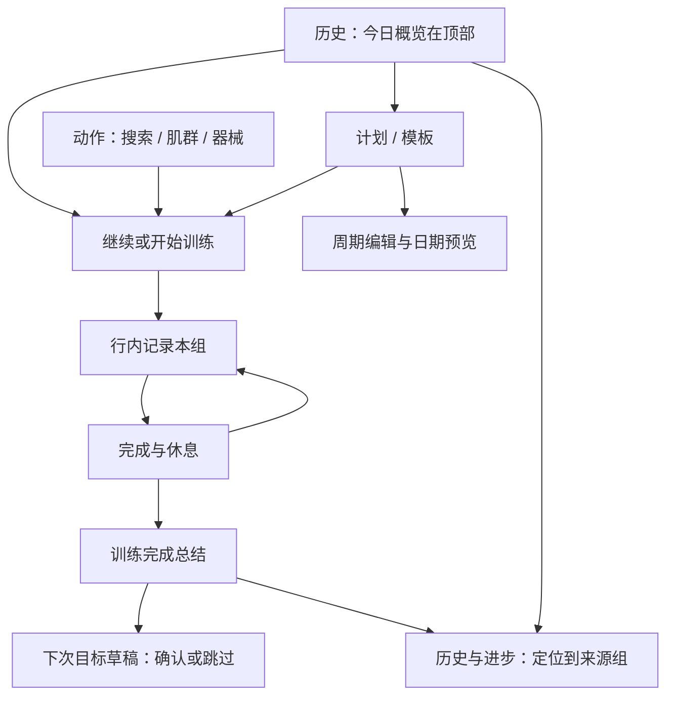

# Leanora Fitness 训练体验迭代计划

## 目标和决策

让日常训练更容易连续记录，让计划能执行多个周期，让每项进步能追溯到真实训练组。基于本地训记 7.0.273 的 REA 静态研究，独立设计和实现；不是训记源码移植，也不把包内页面名称当作真机验证结果。

2026-11-25 输出初版计划。2026-11-26 已实现 1.6 源码并完成自动化验证和本地 Archive；原物理 iPhone 验收与 TestFlight 发行导出仍待完成，详见 [1.6 验证记录](../../app/docs/qa/training-recording-1.6-20261126/README.md)。1.7/1.8 尚未开始，本次没有提交 App Store。

优先顺序：**Health 真机闭环 → 快速训练记录 → 周期与递增规则 → 进步反馈与内容**。保持「历史、动作、饮食、我的」四个 Tab，历史顶部保留今日内容和训练入口。已有饮食流程与数据合同继续回归，不在本轮重写。

研究依据及限制见 [REA 复核报告](../../analysis/2026-11-25-训记-REA复核.md)。后文标注 R/S 的事实来自该报告；标注“设计”的行为是 Leanora 自己的产品规则。

## 已有能力与本轮差异

| 能力 | 当前基线 | 本轮增量 |
|---|---|---|
| 训练记录 | 逐组实际值、上次参考、模板更新、组类型、RPE/RIR、休息、两动作超级组 | 行内输入、连续完成、撤销、持久化状态、动作替换 |
| 计划 | 模板、周几安排、指定训练改期、4 套范例 | 文件夹、有限长度的日历周期、休息日、下一周期草稿 |
| 负重目标 | 固定目标、实际值分离 | 用户配置的双重递增规则、预览、确认、幂等应用 |
| 统计 | 最高实际负重计算、动作历史、两次比较、月历和周回顾 | PR 来源、多时间范围曲线、肌群频率和正式组分布 |
| 动作内容 | 882 动作、284 中文名、100 中文步骤、1,765 唯一图示文件 | 常用 150 动作完整中文内容与适用说明，优先填缺口 |
| Health | 已有授权修复与模拟器写回验证 | 用户设备的原问题复现、诊断、修复和真机验收 |

训记参考线索包括历史复用与模板更新（S1 #25472/#26708）、周期和规则（#25869/#93318/#28167/#92530）、动作替换（#24067）、统计（#87659/#99332）。其具体算法和真实导航尚未验证，以下不照搬未知行为。

## 版本、工期与依赖

按一名熟悉现有项目的 iOS 开发者估算，包含开发、自动化验证和发行准备；内容专业复核可并行。下表不是完成承诺，签名账号、可用真机、内容复核和 Apple 审核等待不计入开发人日。

| 版本 | 核心交付 | 估算 | 依赖与退出条件 |
|---|---|---|---|
| 1.6 | Health 问题闭环；快速逐组记录；休息恢复；训练中替换 | 9–13 人日 | 真机与错误信息；核心记录和 Health 验收通过 |
| 1.7 | 模板组织；周期计划；递增规则与备份兼容 | 12–16 人日 | 1.6 稳定；规则与数据合同先冻结 |
| 1.8 | PR 与肌群趋势；150 个动作中文内容；原创复盘分享卡 | 9–13 人日 | 使用带快照的新训练记录；内容有来源和复核记录 |
| 后续候选 | Widget、实时活动、左右独立记录、手表端 | 不计入前三版 | 各自独立立项；先明确用户需求和平台边界 |

前三版合计约 30–42 人日；内容翻译、编辑与专业复核另留 5–8 人日，可并行。不为等待一个后续模块而阻塞已验证版本的独立发布。

## 1.6：训练过程中少切页、少重输

### A. Health 真机问题闭环（P0，2–3 人日）

**输入和依据：**用户反馈授权页不出现或请求失败；现有修复曾在模拟器通过，但没有用户物理 iPhone 的复现证据。Android 训记分析不提供 Apple Health 结论。

1. 在用户实际安装版本上记录 App 版本、iOS、请求范围、首次/曾请求、前后台状态和 NSError domain/code；不记录健康值、Apple 账号或原始样本。
2. 检查发行包 HealthKit entitlement、用途说明、签名与 provisioning；比较源码、Archive 和实际安装构建，避免只验证 Debug 配置。
3. 连接按钮和自动同步入口走同一授权状态机；防止并发请求；保存配置失败不进入同步；取消后可重试。
4. 页面区分“请求已处理”“可写类型数量”“最近同步时间/错误”，读取权限不做已允许的推断。对曾处理过的范围，明确提供系统健康设置指引，避免把不再弹窗视为必然失败。
5. 逐类型验证体重、训练、饮食营养的选择性写入、读取、重试、撤销、删除及来源隔离；遵守现有旧记录导出确认门槛。

**验收：**用户原设备记录复现结果；新范围可出现系统授权，已处理范围给出正确引导；允许写入后在系统健康 App 查到同源记录；连续重试无重复；取消/拒绝/锁屏后状态正确；不能验证的设备或场景明确列为未覆盖，不用模拟器代替。

Apple 官方说明读取授权不可由 App 判定，写入授权需按类型检查：[授权说明](https://developer.apple.com/documentation/healthkit/authorizing-access-to-health-data)、[authorizationStatus(for:)](https://developer.apple.com/documentation/healthkit/hkhealthstore/authorizationstatus(for:))。

**主要文件：**`HealthAuthorizationService.swift`、`HealthSyncCoordinator.swift`、`HealthConnectionView.swift`、`HealthSyncStatusView.swift`；先定位实际故障，再决定源码改动。

### B. 行内逐组记录（P0，3–4 人日）

**界面设计：**动作卡内按「组号/类型｜上次｜重量｜次数｜完成」排列。计时和有氧分别使用时长/距离，辅助负重、自重保持不同字段含义；窄屏和大字体改成上下两行，避免横向挤压。RPE/RIR、备注和组类型放在展开编辑中，保留现有能力。

- 点数字即可编辑；键盘工具栏提供上一项、下一项和收起；完成本组后聚焦下个未完成组。
- “目标”“上次”是带来源的建议；用户点沿用或明确提交后才成为本次实际值。未完成组不进入完成统计或 Health 导出。
- 完成操作原子提交输入与完成时间。连续点击或重试不重复保存、不重复触发休息；保存失败保留输入草稿并标出该组，允许重试。
- 训练进行中提供撤销最近一次完成；撤销会重新计算该组派生统计，取消或重算由它触发的休息。已完成训练走既有历史编辑路径。已离开页面或重启后，从已保存会话恢复，不承诺恢复尚未成功保存的文字。
- 默认仍为显式“沿用上次”；可选自动带入仅作用于空白未完成组，并展示来源，不覆盖手动编辑。

**验收：**完成三组已带入的卧推不打开编辑弹层，每组一次完成操作；更改重量/次数后完成无丢值；非法输入不能完成；双击不重复；保存失败后重试一致；同动作重复出现时上次匹配不串组；结束和放弃训练边界保持。

**主要文件：**`ActiveWorkoutView.swift`、`WorkoutSessionController.swift`、`WorkoutEngine.swift`、`WorkoutReuse.swift`；建议将组输入视图拆为 `WorkoutSetRow.swift`，不重写整套训练控制器。

### C. 休息与动作替换（P1，2–3 人日）

- 休息条只显示倒计时、跳过、加 30 秒和下一动作；通知是可选提醒，拒绝通知仍能完整训练。
- 倒计时按持久化 deadline 恢复；暂停时保存非负剩余秒数并取消当前提醒，继续时重建 deadline 和提醒。切后台或锁屏不等于暂停。修改或撤销完成的行为写入统一状态机；沿用现有两动作超级组，同轮完成才触发一次休息。
- 动作菜单增加“替换”，按目标肌群、可用器械和计量类型给出候选；默认不自动排名成训练建议，用户选择确认。
- 替换只影响本次未完成部分。原动作已有完成组时保留原条目和组，新动作使用新 ID、空白实际值和可预览的目标；从不把原动作成绩改名为新动作成绩。
- 不同计量类型的目标默认清空；替换预览列明受影响组数及超级组解除情况。取消无写入；确认通过单个事务提交，失败可安全重试。
- 训练完成后的模板变更继续打开现有草稿预览，检查原模板 revision，避免覆盖另一处已保存的修改。

**验收：**锁屏 2 分钟后倒计时准确；超级组不双重提醒；暂停不继续累计动作计时；完成两组后替换，历史中两组仍归原动作；取消和写入失败不出现半次替换。

**主要文件：**`WorkoutEngine.swift`、`WorkoutRepository.swift`、`WorkoutNotificationService.swift`、`WorkoutReuse.swift`；新增小范围 `ExerciseReplacement` 纯函数与选择页。

### D. 1.6 回归与发行准备（2–3 人日）

覆盖旧模板开始、自由训练、暂停/杀进程恢复、五种计量、超级组、完成/放弃、模板更新、备份恢复、饮食和身体记录。通过后更新真实截图、版本说明和审核备注；签名构建与源码哈希对应，TestFlight 验证实际发行包，再按当时发布指令执行送审。

## 1.7：周期计划和明确可控的进阶

### A. 模板组织（2–3 人日）

- 新增模板文件夹、手动排序和置顶；提供默认“全部”，未归类仍可找到。
- 删除文件夹只解除归属；模板和历史保留。模板归档后不被新计划选入，历史快照仍可查看。
- 文件夹、置顶和顺序进入备份；旧备份恢复后自动落入未归类，ID 不变化。

### B. 周期计划（4–5 人日）

**首版范围（设计）：**固定起始日期、2–28 个日历日、训练/休息日、最多预生成一个下一周期草稿。先覆盖常见 3/4/7/8 天循环，不同时实现任意规则语言和“完成后自动滚动”的另一套推进模式。

- 计划编辑器显示完整周期；选择现有模板或休息日；生成前预览具体日期、模板和已有安排冲突。
- 周计划继续可用；同一天可存在多个独立训练，但同一计划发生项只允许开始一次。
- 漏练不自动挪动后续日期。提供“跳过”“改期”；改期目标冲突先预览，用户确认后提交。
- 休息日不生成训练会话、不计入训练次数。下一周期必须预览确认，不能无限后台生成。
- 修改当前计划只影响未来且未开始的发生项；进行中、已完成及已跳过记录保留原计划修订和快照。原模板改名或归档不改历史。
- 首个训练开始后冻结该周期的起始日、长度和时区；需要改变时从下一周期的新修订生效，并重新预览。发生项身份按 program ID + cycle index + day index 稳定生成，改期不换身份；恢复冲突按既有 revision 规则处理。
- 同一发生项重复点击开始、前后台切换及恢复备份后仍幂等；日期运算使用既有日历和时区约定，不用 24 小时秒数替代自然日。

**验收：**7/8 天周期跨月、跨年、夏令时和闰日正确；改期/跳过/计划编辑无重复会话；删除模板和恢复旧备份后能解释缺失引用；恢复预览不悄悄覆盖已有安排。

### C. 递增规则（3–4 人日）

**首版范围（设计）：**仅外部负重正式组的用户配置双重递增，默认关闭。设置目标组数、次数区间、重量增加量和可用最小步进；不根据身体数据自动决定训练强度。

- 触发条件：本次对应项目全部预定正式组完成，每组实际负重与本次计划重量一致，且每组达到次数上限；缺组、失败/放弃、计量变化不满足。重量比较按统一 kg 精度归一后进行；临时变更实际重量时不自动匹配该固定负重规则。热身、递减、力竭组不触发本版规则。
- 依据本次计划重量和规则修订生成“下次目标草稿”。增加重量后次数目标回到下限；取整方法固定为向下取到用户设置步进，结果必须确实大于当前目标，否则提示调整设置。
- 未达条件保持原目标；不自行降载、不从单次失败推断过度训练。没有计划重量时要求用户先设置，不从历史最高值猜测。
- 完成页显示来源训练、规则、前后差异，用户确认后生效；跳过草稿仍保留原计划。首版不静默自动写回模板。
- 同一发生项/模板项目的不同生效规则只能有一条；按来源 session ID + item ID + rule revision 生成稳定应用键。同一训练重试不重复加重。
- 模板版本冲突时拒绝盲目覆盖；源训练被编辑/删除后重算未应用草稿，已应用目标提示来源变化，保留人工处理入口，不自动回滚用户后续训练。

**验收：**刚好达到/差一次/缺一组/同动作重复项目/重复结束/重复确认/规则改版/模板并发修改/小数步进都有确定结果；恢复备份后不重复应用。完整规则以纯函数测试覆盖，UI 只提交用户确认。

### D. 数据与备份兼容、发行回归（3–4 人日）

完成下文实体、引用校验、版本解码和恢复原子性，再回归 1.6。周期和递增不能只做出可点击页面而没有备份/删除/编辑一致性。

## 1.8：看得懂变化，动作内容可直接使用

### A. PR 与统计（4–5 人日）

- 在已有最高实际负重计算上增加 PR 列表与来源定位。首版 PR 类型：外部负重最大实际重量、指定重量的最大次数、单次训练正式组容量；自重次数、计时时长、有氧距离独立展示，辅助负重不当作越大越好。
- 相同数值保留首次达到时间；后续持平标为持平。只从已完成训练的已完成正式组派生，编辑、删除、恢复后可重建，历史不会保留失效的“永久奖章”。
- 4/12 周和自定义日期趋势，点图能打开来源训练；训练内重复出现同动作时先按同次训练合并，保持现有比较口径。
- 肌群频率按“当天至少有一个已完成正式组”的训练天数计算；正式组分布只按明确的主肌群快照计一次，不把多肌群都累加成额外训练总量。旧记录没有快照时列为未分类，允许用户确认回填，不能按今天目录静默改写历史。
- e1RM 为后置可选项：如纳入本版，只对 1–10 次的正外部负重正式组按已标明公式估算，1 次采用实际重量；标成估算，与实测 PR 分栏。没有完成公式、适用范围及边界验证则不进入本版。
- 不根据空白日期推断零摄入，不把 Health 外部训练重复算入本机逐组训练容量。

### B. 动作内容（2–3 人日开发，内容另计）

- 在既有目录选定固定 150 个常用动作 ID，覆盖胸背腿肩臂核心、主要器械和五种计量方式。形成内容清单，先盘点已覆盖项，不把已有 100 条全部算作新增。
- 每条具备中文名/别名、器械、主肌群、动作步骤、常见错误和计量说明；单侧、器械变式等图示适用范围明确可见。
- 使用原有合法图示或另获许可的素材；授权不明的视频不进入目录。本版不承诺全 882 个动作中文化或视频全覆盖。
- 内容通过来源/许可、图片可解码与哈希、动作 ID、专业复核的检查；未经专业复核的内容明确标注状态，不称“已由教练审核”。
- 指导内容仍独立于业务记录，更新不改历史；历史训练只保存必要快照，不复制整段文章或媒体进备份。

### C. 训练总结与分享卡（1–2 人日）

- 完成页用训练时长、正式组数、容量、真实 PR 和下次目标草稿组织反馈，缺失字段留空并说明原因；删去重复口号。
- 独立原创分享版式，用户预览后通过系统分享页导出；默认不带姓名、身体数据和 Health 来源明细，可单独选择显示日期。取消不导出、不发网络请求。
- 对外图片可追溯到当前数据，编辑后重新生成；不复制训记的商标、截图、插图或课程文案。

### D. 1.8 回归与发行准备（2–3 人日）

验证统计编辑/删除重算、旧数据未分类、备份重建、内容离线、大字体和分享预览；真实截图与商店介绍按已交付内容更新。

## 页面和主要流程

训练过程中优先呈现当前动作、数字输入、完成和休息；历史参考靠近对应组。错误发生在对应行，保存成功有简短反馈。危险操作和历史变更保留必要解释，普通页面不新增长篇介绍。空状态给出一个明确入口，不能只展示宣传文案。

## 数据模型与实现约束

沿用原生 SwiftUI、SwiftData 和现有 actor/repository，继续离线使用。REA 原生字段属于 Garmin 投影，不拿它作为 Leanora 存储 schema。

| 模型（建议） | 关键字段 / 关系 | 保存和派生边界 |
|---|---|---|
| `WorkoutSession` / `WorkoutSet` | 继续现有 ID、revision、目标/实际值、完成时间；会话增加可选 `pausedRestRemainingSeconds`；后续可加 `planOccurrenceID` | 实际训练为事实来源；建议不冒充实际值；休息新增字段兼容旧 payload |
| `ExerciseSnapshot` | 可选 `primaryMuscleGroup` 和 `catalogRevision` | 新训练快照固定；旧记录缺失为未知；目录更新不重写历史 |
| `TemplateFolder` | stamp、name、order；模板可选 folderID、pin/order | 删除文件夹只解除关系；引用和顺序校验 |
| `TrainingProgram` | stamp、name、timeZoneID、startLocalDate、cycleLength、dayDefinitions | 周期规则与模板来源修订；一天可为 rest 或绑定模板快照 |
| `ProgramOccurrence` | stamp、programID/revision、cycleIndex、dayIndex、origin/destinationLocalDate、状态、templateSnapshot | 稳定发生项 ID；开始、改期、跳过、替代均有可检查状态 |
| `ProgressionRule` | stamp、作用域、itemID、目标组数/次数、incrementKg、stepKg、enabled | 只用于外部负重；正数、有限值、范围和一项一规则约束 |
| `TargetProposal` | stamp、sessionID、occurrenceID/itemID、ruleRevision、expectedTemplateRevision、前后目标、status、applicationKey | 生成、确认、应用和取消有状态；应用键唯一，目标与应用状态原子提交 |
| `PersonalRecord` / `MuscleTrainingSummary` | 来源 session/exercise/set ID、指标、值、时间、计算版本 | 纯函数投影；可重算，不作为独立事实写进备份 |
| `WorkoutInputDraft` | session/exercise/set ID、输入文字、校验错误 | 页面内草稿；保存成功才进入正式聚合；失败不显示已完成 |

实施决策：

1. 1.6 优先不引入新持久化实体。替换作为训练聚合的一次原子修改；休息仍以会话 deadline 为事实。
2. 1.7 新业务类型进入 `BusinessRecord`、`DomainValidation`、repository、导入导出、删除和清理路径，不能只添加 SwiftUI 状态。引用 ID、嵌套 ID、容量限制、归档和删除必须校验。
3. 增加可选字段时按旧 payload 解码语义设计；需要默认数组或枚举时用显式兼容解码，不能以 Swift 属性默认值代替缺字段处理。
4. 新 record kind 采用备份格式 3。新版本继续读取格式 1/2，格式 3 对旧 App 明确不兼容；旧备份原样保留以便回退。恢复预览列明计划、规则及未应用草稿，不隐藏丢弃数据。
5. 只有 `StoredRecord` 物理结构变化时才新增 SwiftData Schema 版本；扩展 payload 和备份版本不等于必须修改物理表。旧库在迁移或校验失败时保持完整，提供导出与重试，不清空重建。
6. 周期发生项、目标应用和记录保存走现有原子写入边界；Health 写入意图继续与已保存业务变更保持一致。备份恢复保留既有 Health 核对暂停机制，不把计划、PR 或建议写为真实训练样本。
7. 计量仍使用 kg/秒/米的内部单位，显示单位转换不影响规则或 PR。左右独立负重未建模前，不靠普通 `loadKg` 字段隐式加倍。

主要修改范围：

- `Core/Domain/WorkoutModels.swift`、`BusinessRecord.swift`；新增 `Core/Training/TrainingProgram.swift`、`ProgressionRule.swift`、`ExerciseReplacement.swift`。
- `Core/Training/TrainingRepository.swift`、`WorkoutRepository.swift`、`WorkoutEngine.swift`、`WorkoutReuse.swift`；`Core/Backup/BackupService.swift` 与相应 CSV 边界说明。
- `Features/Workout/ActiveWorkoutView.swift`、`WorkoutSessionController.swift`；`Features/Training/TemplateEditorView.swift`、`WeeklyPlanView.swift` 和新增周期编辑页。
- `Core/Analytics/ExerciseProgress.swift`、`TrainingSummary.swift`；`Features/History/ExerciseProgressView.swift`、`JournalReviewView.swift`。
- `Resources/Catalog/exercises.json`、`exercise-guides.json`、内容来源清单和既有测试目录。

以上均相对 `app/ios/Leanora/`；实现时保留用户现有工程文件、Info.plist 和字符串目录的未提交改动。涉及同一文件时先比较并按实际需求合并，不恢复覆盖。

## 验证和发布门槛

| 范围 | 验证方式 | 关键通过条件 |
|---|---|---|
| 核心训练 | Swift 核心测试 + 原生 UI | 行内提交/失败/撤销/重复操作、五种计量、超级组、替换、计时恢复 |
| 周期与规则 | 纯函数测试 + 持久化集成 | 日期边界、一次发生项只开始一次、取整、规则冲突、重复确认、改期和跳过 |
| 迁移和备份 | 真实旧 fixture + 临时库 | 格式 1/2 可读；格式 3 预检/取消/冲突/恢复原子性；ID、历史和 Health 关联稳定 |
| 统计 | 固定数据集 + UI 来源定位 | 热身等组的排除口径、持平、缺失值、编辑/删除重算、旧数据未分类 |
| Health | 原生 transport 测试 + 物理 iPhone | 首次/已处理/取消/部分授权、发行包写回、重试去重、来源删除、锁屏后恢复 |
| 内容和视觉 | 目录校验 + 实机/模拟器 | 150 项清单可验收、来源与许可、离线读取、深浅色、大字体、VoiceOver、较小屏幕 |
| 发行 | Archive 与实际 TestFlight 包 | 源码/构建/版本/签名可追溯；新截图与功能一致；无已知阻塞性数据问题 |

最低支持系统 iOS 18 与当前系统分别列验证结果；无法提供的环境明确未覆盖。测试数量以执行报告为准，不预先承诺“全通过”。建议验证入口沿用 `app/Package.swift` 和 `app/ios/Leanora.xcodeproj`，新增行为测试而非镜像实现的断言。

每版保存需求清单、原始失败及修复复测、截图、源码 commit 和发行记录。Git 提交继续按用户格式：`需求 /Bug`、`Author`、`Thinking Path`（简要决策依据）、`What Changed`、`Verification`、`Risks`、`Model Used`、`Checklist`。送审前确认实际隐私处理是否发生变化；本计划不新增账号、云端健康数据或广告 SDK。

## 暂缓项和剩余不确定性

- **Widget / 实时活动：**Android 小组件桥接只提供产品线索，不代表 iOS 实现方式。后续可用 WidgetKit/ActivityKit；它们是不同能力，需单独处理共享最小快照、锁屏隐私、活动结束/重启对账和禁用回退。先做只读状态，不让扩展直接绕过仓库修改训练。见 [Apple ActivityKit](https://developer.apple.com/documentation/activitykit)、[WidgetKit](https://developer.apple.com/documentation/widgetkit/)。
- **左右独立训练：**R5/R6 有 singleSide/leftWeight 字段，但容量规则未知；待独立定义左右输入、组计数和兼容模型后实现。
- **手表、第三方设备、教练/学员、社区、竞赛、云端分享、付费：**不进入前三版，不因包内有类名就复制完整平台。
- **内容：**训记动作视频、文章、课程、图片和私有接口不进入产品。使用现有可追溯素材或原创内容，专业复核依赖单列。
- **运行证据：**尚未实测训记 7.0.273 的页面跳转、会员限制、规则算法，也没有其 iOS 包；计划中的流程与算法均为 Leanora 自主设计。
- **Health 原问题：**需要用户设备参与验证；开发可先推进，但未复现/未通过时不得将其标记解决。

建议从 1.6-A 的发行包核对与真机诊断、1.6-B 的组行输入原型开始。先验证一条“开始训练 → 连续记三组 → 休息 → 锁屏恢复 → 完成 → 历史回看”的完整路径，再扩展周期规则。
